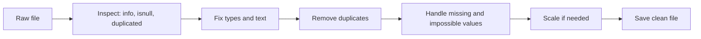

# Session 08: Cleaning Imported Data

> Module: Data Science with Python · Diploma in AI · Term 1 · ⏱ ~2 hours

Real-world data is messy: empty cells, the same customer typed twice, "karachi" and "KARACHI " treated as different cities, ages of 250, dates in four styles and files that show strange symbols instead of letters. There is a famous saying: **"garbage in, garbage out"**. A model trained on dirty data gives wrong answers. This session teaches the standard cleaning toolkit using the deliberately messy file `messy_customers.csv`.

## 🎯 Learning Objectives

- Explain why data cleaning is essential before analysis
- Find missing values and decide whether to drop or impute them
- Remove duplicates, fix inconsistent text and convert wrong data types
- Scale or normalise numeric columns with Min-Max scaling and standardisation
- Parse dates written in different formats
- Explain character encoding and read files saved in a non-UTF-8 encoding

## 📖 Concepts Explained

### 1. What does dirty data look like?

Open `messy_customers.csv` and you will find every common problem:

| Problem | Example in the file | Fix |
|---|---|---|
| Missing values | empty age, city, income | `dropna()` or `fillna()` |
| Hidden missing values | income = "unknown" | `na_values=["unknown"]` or `pd.to_numeric(errors="coerce")` |
| Duplicates | customer 5 appears twice | `drop_duplicates()` |
| Inconsistent text | "karachi", "LAHORE", "karachi " | `.str.strip().str.title()` |
| Impossible values | age 250 | set to NaN, then impute |
| Wrong type | income stored as text | `pd.to_numeric()` |



### 2. Missing values: drop or impute?

pandas shows missing values as `NaN` (numbers/text) or `NaT` (dates).

| Strategy | When to use | Code |
|---|---|---|
| Drop rows | very few rows affected, lots of data | `df.dropna()` |
| Drop a column | column mostly empty | `df.drop(columns=["col"])` |
| Fill with mean | numeric, no extreme values | `df["c"].fillna(df["c"].mean())` |
| Fill with median | numeric with outliers (income, age) | `df["c"].fillna(df["c"].median())` |
| Fill with mode / label | categorical | `df["c"].fillna("Unknown")` |
| Forward fill | time series (yesterday's value) | `df["c"].ffill()` |

> **Analogy:** If one student missed a quiz, you do not cancel the whole class result (drop everything). You might give the class median for that quiz (impute) so the student can still be included.

### 3. Duplicates, text and types

- `df.duplicated()` marks repeated rows; `df.drop_duplicates()` removes them. Use `subset=["customer_id"]` to compare only certain columns.
- The `.str` accessor applies string methods to a whole column: `strip()`, `lower()`, `upper()`, `title()`, `replace()`.
- `pd.to_numeric(col, errors="coerce")` turns numbers-stored-as-text into real numbers and any bad value into `NaN`.

### 4. Scaling and normalising

Columns like **age (20-60)** and **income (40,000-210,000)** have very different ranges. Many algorithms (KNN, SVM, k-means) measure distance, so the big column would dominate. Scaling fixes that.

| Method | Formula | Result |
|---|---|---|
| **Min-Max normalisation** | (x − min) / (max − min) | values between 0 and 1 |
| **Standardisation (z-score)** | (x − mean) / std | mean 0, standard deviation 1 |

> Tip: Use Min-Max when you need a fixed 0-1 range; use standardisation when data has outliers or the algorithm assumes centred data.

### 5. Parsing dates

Text like `"05/03/2026"` is ambiguous: 5 March or 3 May? Always tell pandas the format.

| Code | Meaning |
|---|---|
| `%Y` / `%y` | 2026 / 26 |
| `%m` | month number 01-12 |
| `%d` | day 01-31 |
| `%B` / `%b` | March / Mar |

`pd.to_datetime(col, format="%d-%m-%Y")` parses one known format; `errors="coerce"` turns bad dates into `NaT`.

### 6. Character encoding

Computers store text as **bytes**. An **encoding** is the table that maps bytes to characters.

| Encoding | Notes |
|---|---|
| **UTF-8** | modern standard, supports every language including Urdu; use it always |
| cp1252 / latin-1 | older Windows and Excel exports, Western letters only |
| UTF-16 | some Windows tools and Excel "Unicode text" |

If you see `UnicodeDecodeError` or garbage like `Café`, the file was read with the wrong encoding. Try `pd.read_csv(file, encoding="cp1252")`, then save your clean copy as UTF-8.

## 💻 Code Examples

### Example 1: Missing values

📄 File: [`missing_values.py`](./missing_values.py)

```python
# missing_values.py
# Finding and filling (imputing) missing values.

import numpy as np
import pandas as pd

# na_values tells pandas to treat the word "unknown" as missing too
df = pd.read_csv("messy_customers.csv", na_values=["unknown"])

# 1) FIND missing values
print("Missing values per column:\n", df.isnull().sum(), "\n")
print("Rows that have at least one missing value:\n", df[df.isnull().any(axis=1)], "\n")

# 2) Option A: DROP rows with missing values (simple, but we lose data)
dropped = df.dropna()
print("Rows before:", len(df), " after dropna:", len(dropped))

# 3) Option B: FILL (impute) missing values - usually better
filled = df.copy()
filled["age"] = filled["age"].fillna(filled["age"].median())              # numbers -> median
filled["monthly_income"] = filled["monthly_income"].fillna(filled["monthly_income"].mean().round())
filled["city"] = filled["city"].fillna("Unknown")                         # text -> a label
print("\nMissing after filling:", filled.isnull().sum().sum())
print(filled[["name", "city", "age", "monthly_income"]])

# 4) A value that is present but WRONG (age 250) - treat it as missing, then fill
filled.loc[filled["age"] > 100, "age"] = np.nan
filled["age"] = filled["age"].fillna(filled["age"].median())
print("\nAges after fixing the impossible value:", filled["age"].tolist())
```

**How it works:** `na_values` turns "unknown" into NaN while reading. `isnull().sum()` counts gaps. We compare dropping with filling: median for age, mean for income, a label for city. The impossible age is replaced by NaN and filled the same way.

### Example 2: Duplicates, text and types

📄 File: [`duplicates_and_text.py`](./duplicates_and_text.py)

```python
# duplicates_and_text.py
# Removing duplicate rows and fixing messy text.

import pandas as pd

df = pd.read_csv("messy_customers.csv")

# 1) Duplicates
print("Duplicate rows:", df.duplicated().sum())
df = df.drop_duplicates()
print("Rows after removing duplicates:", len(df))

# 2) Messy text: extra spaces and mixed CAPITAL/small letters
print("\nCities before:", df["city"].unique().tolist())
df["city"] = df["city"].str.strip().str.title()     # remove spaces, then "Karachi" style
df["name"] = df["name"].str.strip().str.title()
print("Cities after: ", df["city"].unique().tolist())
print("Names:", df["name"].tolist())

# 3) A column that should be numbers but contains text ("unknown")
print("\nIncome type before:", df["monthly_income"].dtype)
df["monthly_income"] = pd.to_numeric(df["monthly_income"], errors="coerce")  # bad text -> NaN
print("Income type after: ", df["monthly_income"].dtype)

# 4) Save the cleaner file
df.to_csv("customers_clean.csv", index=False)
print("\nSaved customers_clean.csv")
```

**How it works:** `drop_duplicates()` removes the repeated customer. `.str.strip().str.title()` makes all city spellings identical. `pd.to_numeric(..., errors="coerce")` converts income to numbers.

### Example 3: Scaling and normalising

📄 File: [`scaling_normalising.py`](./scaling_normalising.py)

```python
# scaling_normalising.py
# Putting columns with very different ranges on the same scale.

import pandas as pd
from sklearn.preprocessing import MinMaxScaler, StandardScaler

df = pd.DataFrame({
    "age": [22, 35, 47, 29, 58],
    "income": [40000, 85000, 150000, 60000, 210000],
})
print("Original:\n", df, "\n")

# 1) Min-Max scaling by hand: (x - min) / (max - min) -> values between 0 and 1
manual = (df - df.min()) / (df.max() - df.min())
print("Min-Max (by hand):\n", manual.round(2), "\n")

# 2) The same with scikit-learn
minmax = MinMaxScaler()
scaled = minmax.fit_transform(df)                 # returns a NumPy array
print("Min-Max (sklearn):\n", pd.DataFrame(scaled, columns=df.columns).round(2), "\n")

# 3) Standardisation (z-score): (x - mean) / std -> mean 0, std 1
standard = StandardScaler()
z = standard.fit_transform(df)
z_df = pd.DataFrame(z, columns=df.columns).round(2)
print("Standardised:\n", z_df)
print("Mean of each column after:", z_df.mean().round(2).tolist())
```

**How it works:** the manual formula and `MinMaxScaler` give the same 0-1 values. `StandardScaler` centres each column on 0 with a spread of 1. `fit_transform` learns min/max (or mean/std) and applies them in one step.

### Example 4: Parsing dates

📄 File: [`parsing_dates.py`](./parsing_dates.py)

```python
# parsing_dates.py
# Turning text into real dates so we can calculate with them.

import pandas as pd

# 1) Dates stored as text in different styles
orders = pd.DataFrame({
    "order": ["A1", "A2", "A3", "A4"],
    "date_text": ["2026-03-05", "05/03/2026", "March 7, 2026", "2026.03.09"],
})

# 2) Try a list of known formats, one after another, for each text value
#    (%Y = 4-digit year, %m = month number, %d = day, %B = full month name)
known_formats = ["%Y-%m-%d", "%d/%m/%Y", "%B %d, %Y", "%Y.%m.%d"]

def parse_date(text):
    for fmt in known_formats:
        try:
            return pd.to_datetime(text, format=fmt)   # works -> return the date
        except ValueError:
            pass                                      # wrong format -> try the next one
    return pd.NaT                                     # nothing matched -> missing date

orders["date"] = orders["date_text"].apply(parse_date)
print(orders, "\n")
print("Type now:", orders["date"].dtype)

# 3) A single known format: say it exactly with format=
text = pd.Series(["15-01-2026", "28-02-2026"])
dates = pd.to_datetime(text, format="%d-%m-%Y")     # %d day, %m month, %Y 4-digit year
print("\nParsed with format:", dates.dt.date.tolist())

# 4) Bad dates become NaT (Not a Time) instead of crashing
bad = pd.to_datetime(pd.Series(["2026-01-10", "not a date"]), errors="coerce")
print("With a bad value:", bad.tolist())

# 5) Now we can do date maths
orders["weekday"] = orders["date"].dt.day_name()
orders["days_since_first"] = (orders["date"] - orders["date"].min()).dt.days
print("\n", orders[["order", "date", "weekday", "days_since_first"]])
```

**How it works:** `parse_date` tries each known format until one fits, so every style becomes a real date. With real dates we can get weekday names and subtract dates to get days.

### Example 5: Character encoding

📄 File: [`character_encoding.py`](./character_encoding.py)

```python
# character_encoding.py
# Text is stored as bytes. The ENCODING is the rule that maps bytes to letters.

import pandas as pd

# 1) Encode and decode a string with Urdu text
text = "Café - کراچی"
as_bytes = text.encode("utf-8")
print("Text:", text)
print("UTF-8 bytes:", as_bytes)
print("Number of characters:", len(text), " Number of bytes:", len(as_bytes))
print("Decoded back:", as_bytes.decode("utf-8"))

# 2) Decoding with the WRONG encoding gives garbage (called "mojibake")
print("Wrong decoding:", as_bytes.decode("latin-1"))

# 3) Save a CSV in an older encoding (cp1252 is common for files from old Windows/Excel)
df = pd.DataFrame({"product": ["Café latte", "Crème brûlée"], "price": [450, 600]})
df.to_csv("menu_cp1252.csv", index=False, encoding="cp1252")

# 4) Reading it as UTF-8 fails...
try:
    pd.read_csv("menu_cp1252.csv", encoding="utf-8")
except UnicodeDecodeError as error:
    print("\nUTF-8 failed:", str(error)[:60], "...")

# 5) ...but reading with the correct encoding works
menu = pd.read_csv("menu_cp1252.csv", encoding="cp1252")
print("Read with cp1252:\n", menu)

# 6) Best practice: save your own files as UTF-8
menu.to_csv("menu_utf8.csv", index=False, encoding="utf-8")
print("Saved menu_utf8.csv in UTF-8")
```

**How it works:** Urdu letters need 2 bytes each in UTF-8, so the byte count is larger. Decoding with the wrong table gives mojibake. A CSV saved as cp1252 fails as UTF-8 but opens correctly when we name its real encoding.

## 🧪 Lab Practice

1. Combine Examples 1 and 2 into one script `clean_customers.py` that outputs a fully clean file with no missing values or duplicates.
2. Fill missing `city` values with the **most common** city instead of "Unknown" (hint: `df["city"].mode()[0]`).
3. Apply Min-Max scaling to `age` and `monthly_income` of the cleaned file.
4. Add a column `months_since_join` calculated from `join_date` to today's date.
5. Save the cleaned file in UTF-8 and open it in Excel to check that names look correct.

## 📝 Assignment

Create your own messy CSV of 15 products with at least one example of each problem in the table in section 1 (missing value, "N/A" text, duplicate, mixed-case category, impossible price, mixed date formats). Write `clean_products.py` that fixes all problems with comments explaining each decision, and prints a before/after summary (`shape` and `isnull().sum()`).

## ❓ Quick Quiz

1. Why is the median often better than the mean for filling missing income values?
2. What does `errors="coerce"` do in `pd.to_numeric`?
3. Write the Min-Max formula.
4. Which code removes extra spaces and makes "kARACHI " into "Karachi"?
5. What error usually means you used the wrong encoding?

<details><summary>Answers</summary>

1. The median is not pulled up or down by extreme values (outliers)
2. Converts values it cannot parse into NaN instead of raising an error
3. (x − min) / (max − min)
4. `df["city"].str.strip().str.title()`
5. `UnicodeDecodeError`

</details>

## 💼 Interview Questions

1. **How do you handle missing data?** First find how much and why it is missing; then drop rows/columns if the loss is small, or impute with mean/median/mode, forward fill, or a model, and document the choice.
2. **Normalisation vs standardisation?** Normalisation rescales to a fixed range like 0-1; standardisation rescales to mean 0 and standard deviation 1.
3. **Why should a scaler be fitted only on training data?** Fitting on all data leaks information about the test set into training, making results look better than they really are.

## ✅ Summary

- Inspect first, then fix types and text, remove duplicates, handle missing and impossible values.
- Use median for skewed numbers, a label or mode for categories.
- Scale features for distance-based algorithms: Min-Max or z-score.
- Parse dates with explicit formats; bad values become NaT.
- Read with the file's real encoding; save your own files as UTF-8.

---

[⬅ Previous](../Session-07-Handling-Different-File-Formats/README.md) · [🏠 Module Home](../README.md) · [Next ➡](../Session-09-Data-Visualization-with-Matplotlib/README.md)

Prepared by Zeeshan Abbas · Aptech Learning North Nazimabad
