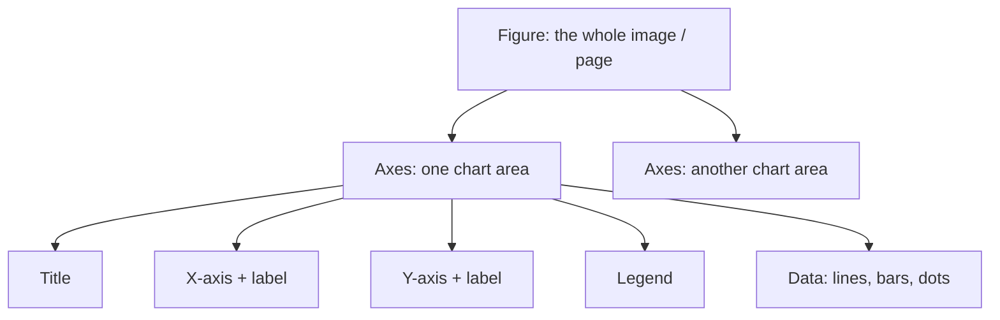
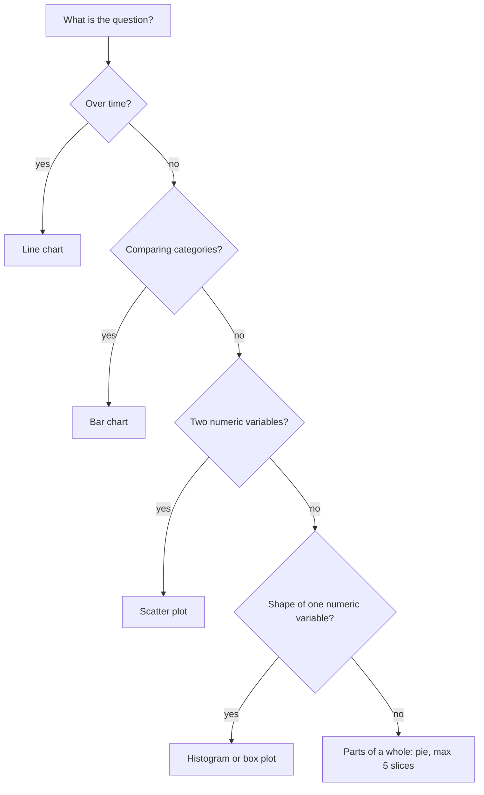
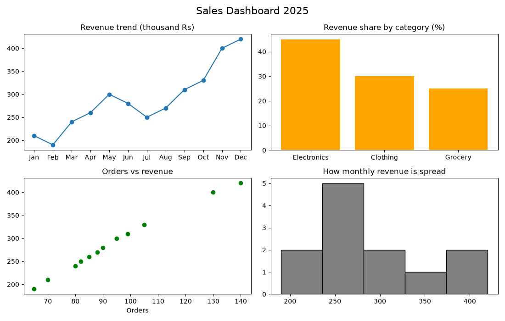

# Session 09: Data Visualization with Matplotlib

> Module: Data Science with Python · Diploma in AI · Term 1 · ⏱ ~2 hours

A good chart can explain in five seconds what a table explains in five minutes. **Matplotlib** is Python's original and most widely used plotting library; pandas and Seaborn are built on it. In this session you will draw the six chart types every analyst needs, learn how to pick the right one for a question, and combine several charts into a mini dashboard. Every script saves its chart as a `.png` file in this folder.

## 🎯 Learning Objectives

- Explain why graphs and plots are important in data analysis
- Distinguish between line, bar, histogram, scatter, pie and box plots
- Choose a plot type based on the problem statement
- Customise charts with titles, labels, legends, colours, grids and value labels
- Build a multi-chart figure with `subplots`
- Read insights (trends, comparisons, relationships, outliers) from plots

## 📖 Concepts Explained

### 1. Why graphs matter

- **Speed**: patterns are visible instantly.
- **Hidden problems**: outliers and errors stand out (a dot far from the others).
- **Storytelling**: managers and clients remember pictures, not tables.
- **Checking assumptions**: many models assume data is roughly bell-shaped; a histogram tells you quickly.

### 2. Anatomy of a Matplotlib chart



| Term | Meaning |
|---|---|
| **Figure** | the full canvas (`plt.figure(figsize=(w, h))`) |
| **Axes** | one plot inside the figure (a figure can hold many) |
| `plt.title / xlabel / ylabel` | text around the chart |
| `plt.legend()` | box explaining each line or colour (needs `label=`) |
| `plt.savefig("file.png")` | write the chart to a file |
| `plt.tight_layout()` | stops labels from overlapping or being cut |

### 3. The main plot types

| Plot | Function | Question it answers | Example |
|---|---|---|---|
| Line | `plt.plot()` | How does it change over time? | monthly sales |
| Bar | `plt.bar()`, `plt.barh()` | Which category is bigger? | students per course |
| Histogram | `plt.hist()` | How are values distributed? | spread of exam marks |
| Scatter | `plt.scatter()` | Are two numbers related? | study hours vs marks |
| Pie | `plt.pie()` | What share of the whole? | payment method share |
| Box | `plt.boxplot()` | Median, spread, outliers? | delivery days per courier |

> **Bar vs histogram:** a bar chart compares **categories** (Python, SQL); a histogram groups **numbers** into ranges (60-65, 65-70) and the bars touch.

### 4. Choosing a plot from the problem statement



### 5. Reading a box plot

The **box** covers the middle 50% of values (from the 25th to the 75th percentile, called Q1 to Q3); the line inside is the **median**; the **whiskers** reach the furthest normal values; separate **dots are outliers**. In `box_plot.png`, courier C is usually fastest but has two very late deliveries.

### 6. Good chart habits

- Always add a title and axis labels with units.
- Start bar charts at zero, otherwise differences look larger than they are.
- Avoid pie charts with more than 5 slices; use a bar chart instead.
- Use colour to highlight, not decorate.

## 💻 Code Examples

### Example 1: Line chart

📄 File: [`line_chart.py`](./line_chart.py)

```python
# line_chart.py
# Line chart = how something changes over time.

import matplotlib
matplotlib.use("Agg")                 # save to file instead of opening a window
import matplotlib.pyplot as plt

months = ["Jan", "Feb", "Mar", "Apr", "May", "Jun"]
karachi = [120, 135, 128, 160, 172, 150]
lahore = [100, 110, 125, 130, 128, 145]

plt.figure(figsize=(7, 4))                                   # width, height in inches
plt.plot(months, karachi, marker="o", label="Karachi")       # marker = dot on each point
plt.plot(months, lahore, marker="s", linestyle="--", label="Lahore")
plt.title("Monthly Sales (thousand Rs)")
plt.xlabel("Month")
plt.ylabel("Sales")
plt.grid(True, alpha=0.3)                                    # light background grid
plt.legend()                                                 # shows the labels box
plt.tight_layout()
plt.savefig("line_chart.png", dpi=100)
print("Saved line_chart.png")
```

**How it works:** each `plt.plot` call adds one line. `marker` puts a dot on each month and `linestyle="--"` makes a dashed line. `label` plus `legend()` explains which line is which.

### Example 2: Bar charts

📄 File: [`bar_chart.py`](./bar_chart.py)

```python
# bar_chart.py
# Bar chart = compare amounts between categories.

import matplotlib
matplotlib.use("Agg")
import matplotlib.pyplot as plt

courses = ["Python", "SQL", "MongoDB", "Statistics"]
students = [45, 38, 30, 25]

# 1) Vertical bars
plt.figure(figsize=(6, 4))
bars = plt.bar(courses, students, color=["#4C72B0", "#55A868", "#C44E52", "#8172B2"])
plt.bar_label(bars)                     # write the value on top of each bar
plt.title("Enrolled Students per Course")
plt.ylabel("Students")
plt.tight_layout()
plt.savefig("bar_chart.png")

# 2) Horizontal bars are easier to read when labels are long
plt.figure(figsize=(6, 4))
plt.barh(courses, students, color="teal")
plt.title("Enrolled Students (horizontal)")
plt.xlabel("Students")
plt.tight_layout()
plt.savefig("barh_chart.png")
print("Saved bar_chart.png and barh_chart.png")
```

**How it works:** `plt.bar` returns the bars so `bar_label` can print the numbers on them. `barh` draws horizontal bars, which are easier to read with long labels.

### Example 3: Histogram

📄 File: [`histogram.py`](./histogram.py)

```python
# histogram.py
# Histogram = how values are spread out (the distribution).

import matplotlib
matplotlib.use("Agg")
import matplotlib.pyplot as plt
import numpy as np

rng = np.random.default_rng(seed=1)
marks = rng.normal(loc=65, scale=12, size=300)   # 300 marks around 65
marks = np.clip(marks, 0, 100)                    # keep them between 0 and 100

plt.figure(figsize=(7, 4))
plt.hist(marks, bins=15, color="skyblue", edgecolor="black")   # bins = number of bars
plt.axvline(marks.mean(), color="red", linestyle="--", label=f"Mean = {marks.mean():.1f}")
plt.title("Distribution of Final Marks (300 students)")
plt.xlabel("Marks")
plt.ylabel("Number of students")
plt.legend()
plt.tight_layout()
plt.savefig("histogram.png")
print("Saved histogram.png")
```

**How it works:** 300 random marks are grouped into 15 ranges (`bins`). The red dashed line from `axvline` marks the average, so you can see most students sit near the middle.

### Example 4: Scatter plot

📄 File: [`scatter_plot.py`](./scatter_plot.py)

```python
# scatter_plot.py
# Scatter plot = is there a relationship between two numeric columns?

import matplotlib
matplotlib.use("Agg")
import matplotlib.pyplot as plt
import numpy as np

rng = np.random.default_rng(seed=3)
study_hours = rng.uniform(0, 8, size=50)                         # 50 students
marks = 35 + study_hours * 7 + rng.normal(0, 6, size=50)         # more hours -> more marks

plt.figure(figsize=(6, 4))
plt.scatter(study_hours, marks, color="purple", alpha=0.7)       # alpha = transparency
plt.title("Study Hours vs Marks")
plt.xlabel("Study hours per day")
plt.ylabel("Marks")
plt.grid(True, alpha=0.3)
plt.tight_layout()
plt.savefig("scatter_plot.png")

# The correlation number tells us how strong the straight-line relationship is
correlation = np.corrcoef(study_hours, marks)[0, 1]
print("Saved scatter_plot.png | correlation =", round(correlation, 2))
```

**How it works:** each dot is one student. The points rise from left to right, and `np.corrcoef` confirms a strong positive relationship (close to 1).

### Example 5: Pie and box plot

📄 File: [`pie_and_box.py`](./pie_and_box.py)

```python
# pie_and_box.py
# Pie chart = parts of a whole.  Box plot = median, spread and outliers.

import matplotlib
matplotlib.use("Agg")
import matplotlib.pyplot as plt
import numpy as np

# ---- Pie chart: share of each payment method ----
methods = ["Cash on Delivery", "Card", "JazzCash", "EasyPaisa"]
share = [45, 25, 18, 12]

plt.figure(figsize=(5, 5))
plt.pie(share, labels=methods, autopct="%1.0f%%", startangle=90)   # autopct writes the %
plt.title("Payment Methods")
plt.tight_layout()
plt.savefig("pie_chart.png")

# ---- Box plot: delivery time (days) for three couriers ----
rng = np.random.default_rng(seed=5)
courier_a = rng.normal(3, 0.8, 40)
courier_b = rng.normal(4, 1.5, 40)
courier_c = np.append(rng.normal(2.5, 0.5, 38), [7, 8])   # two very late deliveries

plt.figure(figsize=(6, 4))
plt.boxplot([courier_a, courier_b, courier_c], tick_labels=["A", "B", "C"])
plt.title("Delivery Time by Courier")
plt.ylabel("Days")
plt.tight_layout()
plt.savefig("box_plot.png")
print("Saved pie_chart.png and box_plot.png")
```

**How it works:** `autopct` writes percentages on the slices. `boxplot` takes a list of arrays (one box each) and automatically draws outliers as dots.

### Example 6: Dashboard with subplots

📄 File: [`subplots_dashboard.py`](./subplots_dashboard.py)

```python
# subplots_dashboard.py
# Several charts in ONE image = a small dashboard. Answers a problem statement:
# "The manager wants to understand last year's sales at a glance."

import matplotlib
matplotlib.use("Agg")
import matplotlib.pyplot as plt
import pandas as pd

sales = pd.DataFrame({
    "month": ["Jan", "Feb", "Mar", "Apr", "May", "Jun", "Jul", "Aug", "Sep", "Oct", "Nov", "Dec"],
    "revenue": [210, 190, 240, 260, 300, 280, 250, 270, 310, 330, 400, 420],
    "orders": [70, 65, 80, 85, 95, 90, 82, 88, 99, 105, 130, 140],
})
category = pd.Series({"Electronics": 45, "Clothing": 30, "Grocery": 25})

# 2 rows x 2 columns of charts
fig, axes = plt.subplots(2, 2, figsize=(11, 7))

axes[0, 0].plot(sales["month"], sales["revenue"], marker="o")       # trend
axes[0, 0].set_title("Revenue trend (thousand Rs)")

axes[0, 1].bar(category.index, category.values, color="orange")     # comparison
axes[0, 1].set_title("Revenue share by category (%)")

axes[1, 0].scatter(sales["orders"], sales["revenue"], color="green") # relationship
axes[1, 0].set_title("Orders vs revenue")
axes[1, 0].set_xlabel("Orders")

axes[1, 1].hist(sales["revenue"], bins=5, color="gray", edgecolor="black")  # distribution
axes[1, 1].set_title("How monthly revenue is spread")

fig.suptitle("Sales Dashboard 2025", fontsize=16)
fig.tight_layout()
fig.savefig("dashboard.png")

# Insights we can read from the charts
best = sales.loc[sales["revenue"].idxmax(), "month"]
print("Saved dashboard.png")
print("Insight 1: best month is", best)
print("Insight 2: revenue grows strongly in the last quarter")
print("Insight 3: more orders -> more revenue (points rise left to right)")
```

**How it works:** `plt.subplots(2, 2)` returns a figure and a 2x2 grid of axes. We draw one chart per axes with methods like `axes[0, 0].plot(...)` and `set_title(...)`, then save one image.



**Insights from the dashboard:** revenue rises strongly in the last quarter, electronics brings the largest share, and orders and revenue move together.

## 🧪 Lab Practice

1. Change `line_chart.py` to add a third city (Islamabad) with its own colour and marker.
2. Draw a bar chart of the total sales per city from `sales.csv` (Session 04) using `groupby` and `plt.bar`.
3. Make a histogram of `unit_price` from `sales.csv` with 8 bins and describe its shape.
4. Draw a scatter plot of `quantity` vs `total` and say whether they are related.
5. Build a 1x3 subplot figure (bar, pie, box) for any data you like and save it.

## 📝 Assignment

Problem statement: *"A school wants to understand last term's results."* Create data for 40 students (`gender`, `section`, `attendance`, `marks`). Draw and save four charts, each answering one question: (1) marks distribution, (2) average marks per section, (3) attendance vs marks, (4) marks by gender as box plots. Write one insight sentence per chart in comments at the end of the script.

## ❓ Quick Quiz

1. Which plot shows the distribution of a single numeric column?
2. What is the difference between `Figure` and `Axes`?
3. Which function writes a chart to a PNG file?
4. Which chart would you use to compare the number of students in 4 courses?
5. In a box plot, what does a dot far above the whisker mean?

<details><summary>Answers</summary>

1. Histogram (or box plot)
2. Figure is the whole canvas; Axes is one plot area inside it
3. `plt.savefig("name.png")`
4. Bar chart
5. An outlier: an unusually high value

</details>

## 💼 Interview Questions

1. **When would you avoid a pie chart?** When there are many categories or values are close together; humans compare bar lengths more accurately than angles.
2. **What is the difference between `plt.plot()` (pyplot style) and `fig, ax = plt.subplots()` (object style)?** Pyplot draws on the "current" chart and is quick for one plot; the object style gives explicit control and is better for multiple subplots.
3. **How would you show the relationship between three variables?** A scatter plot with the third variable as colour or marker size, or a 3-D plot.

## ✅ Summary

- Charts reveal trends, comparisons, relationships, distributions and outliers.
- Line = time, bar = categories, histogram = distribution, scatter = relationship, pie = share, box = spread/outliers.
- Always title, label and save your charts with `savefig`.
- `plt.subplots(rows, cols)` builds dashboards from several charts.

---

[⬅ Previous](../Session-08-Cleaning-Imported-Data/README.md) · [🏠 Module Home](../README.md) · [Next ➡](../Session-10-Practice-Lab-Files-Cleaning-and-Charts/README.md)

Prepared by Zeeshan Abbas · Aptech Learning North Nazimabad
