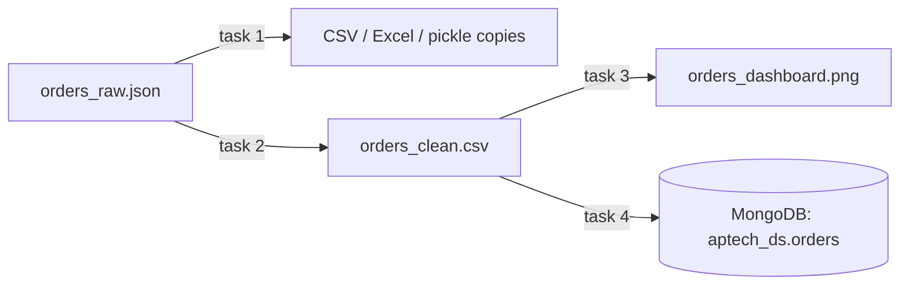
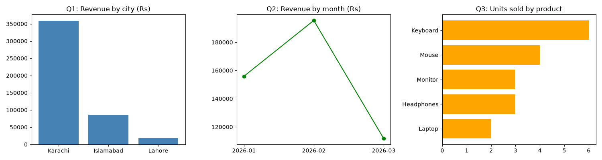

# Session 10: Practice Lab - Files, Cleaning and Charts

> Module: Data Science with Python · Diploma in AI · Term 1 · ⏱ ~2 hours

This hands-on lab revises Sessions 06 to 09 with one realistic mini pipeline. You receive a messy JSON export of computer-shop orders (`orders_raw.json`), convert it to other formats, clean it, store it in MongoDB, and present the answers as charts. This is exactly how a junior data analyst spends a normal working day.

## 🎯 Learning Objectives

- Read JSON and convert data between CSV, Excel and pickle (Session 07)
- Clean duplicates, messy text, impossible and missing values (Session 08)
- Answer business questions with the right Matplotlib charts (Session 09)
- Store and query cleaned data in MongoDB with PyMongo (Session 06)
- Connect separate steps into one repeatable pipeline

## 📖 Concepts Explained

### 1. The pipeline you will build



Run the tasks **in order**, from inside this folder: task 2 creates `orders_clean.csv`, which tasks 3 and 4 need.

### 2. Problems hidden in the raw file

| Row | Problem | Planned fix |
|---|---|---|
| order 3 | price is `null` | median price of the same product |
| order 4 | appears twice | `drop_duplicates()` |
| order 5 | city is `null` | most common city (`mode`) |
| order 6 | qty is −2, name has spaces | treat as missing → 1; `str.strip().str.title()` |
| order 10 | qty is `null` | assume 1 |
| several | "lahore", "KARACHI" | `str.title()` |

### 3. New tools in this lab

| Tool | What it does |
|---|---|
| `pd.read_json("file.json")` | reads a JSON list of records straight into a DataFrame |
| `groupby("product")["price"].transform("median")` | gives every row the median of **its own group**, same length as the DataFrame, so it can fill gaps row by row |
| `series.mode()[0]` | the most frequent value |
| `df.to_dict(orient="records")` | DataFrame → list of dicts, ready for `insert_many` |
| `dt.strftime("%Y-%m")` | date → "2026-03" text for monthly grouping |

> **Analogy for `transform`:** `groupby().median()` gives you one answer per product (a short list). `transform("median")` writes that answer next to every order of that product, like a teacher writing the class average on every student's report card.

### 4. Choosing charts for the questions

| Question | Chart |
|---|---|
| Q1 Which city spends the most? | bar chart |
| Q2 How do sales change by month? | line chart |
| Q3 Which products sell the most units? | horizontal bar chart |

## 💻 Code Examples

### Task 1 (Session 07): Load JSON and convert formats

📄 File: [`task1_load_formats.py`](./task1_load_formats.py)

```python
# task1_load_formats.py  (Practice for Session 07)
# Task: read the raw JSON file, then save the same data as CSV, Excel and pickle.

import json
import pandas as pd

# Step 1: read JSON with the json module and look at the first record
with open("orders_raw.json", "r", encoding="utf-8") as file:
    records = json.load(file)
print("Number of records:", len(records))
print("First record:", records[0])

# Step 2: turn the list of dictionaries into a DataFrame
orders = pd.DataFrame(records)
print("\n", orders.head())

# Step 3: save in three other formats
orders.to_csv("orders_raw.csv", index=False)
orders.to_excel("orders_raw.xlsx", index=False)      # needs openpyxl
orders.to_pickle("orders_raw.pkl")
print("\nSaved CSV, Excel and pickle copies")

# Step 4: prove all copies hold the same number of rows
print("CSV rows:", len(pd.read_csv("orders_raw.csv")))
print("Excel rows:", len(pd.read_excel("orders_raw.xlsx")))
print("Pickle rows:", len(pd.read_pickle("orders_raw.pkl")))
```

**How it works:** `json.load` gives a list of dictionaries, which becomes a DataFrame. We save CSV, Excel and pickle copies and read each back to confirm the row count matches.

### Task 2 (Session 08): Clean the orders

📄 File: [`task2_clean_orders.py`](./task2_clean_orders.py)

```python
# task2_clean_orders.py  (Practice for Session 08)
# Task: clean the raw orders and save orders_clean.csv

import numpy as np
import pandas as pd

orders = pd.read_json("orders_raw.json")
print("Before cleaning:", orders.shape)
print(orders.isnull().sum(), "\n")

# Step 1: remove the duplicate order
orders = orders.drop_duplicates()

# Step 2: tidy text columns
orders["customer"] = orders["customer"].str.strip().str.title()
orders["city"] = orders["city"].str.strip().str.title()

# Step 3: impossible quantity (negative) -> missing
orders.loc[orders["qty"] < 0, "qty"] = np.nan

# Step 4: fill missing values
orders["qty"] = orders["qty"].fillna(1)                             # assume 1 item
orders["city"] = orders["city"].fillna(orders["city"].mode()[0])    # most common city
# missing price -> median price of the SAME product
orders["price"] = orders["price"].fillna(orders.groupby("product")["price"].transform("median"))
# if a product had no other price, fall back to the overall median
orders["price"] = orders["price"].fillna(orders["price"].median())

# Step 5: correct types and a new column
orders["qty"] = orders["qty"].astype(int)
orders["order_date"] = pd.to_datetime(orders["order_date"], format="%Y-%m-%d")
orders["total"] = orders["price"] * orders["qty"]

print("After cleaning:", orders.shape, "| missing values:", orders.isnull().sum().sum())
print(orders[["customer", "city", "product", "price", "qty", "total"]])
orders.to_csv("orders_clean.csv", index=False)
print("\nSaved orders_clean.csv")
```

**How it works:** duplicates go first, then text is tidied. The negative quantity becomes NaN so the same filling rule handles it. Missing prices are filled per product with `transform("median")`, and finally types are corrected and a `total` column is added.

### Task 3 (Session 09): Answer questions with charts

📄 File: [`task3_charts.py`](./task3_charts.py)

```python
# task3_charts.py  (Practice for Session 09)
# Task: answer 3 questions with charts. Run task2_clean_orders.py first.

import matplotlib
matplotlib.use("Agg")
import matplotlib.pyplot as plt
import pandas as pd

orders = pd.read_csv("orders_clean.csv", parse_dates=["order_date"])

# Q1: Which city spends the most? -> bar chart
city_total = orders.groupby("city")["total"].sum().sort_values(ascending=False)

# Q2: How do sales change by month? -> line chart
orders["month"] = orders["order_date"].dt.strftime("%Y-%m")
monthly = orders.groupby("month")["total"].sum()

# Q3: Which products sell the most units? -> horizontal bar chart
units = orders.groupby("product")["qty"].sum().sort_values()

fig, axes = plt.subplots(1, 3, figsize=(15, 4))
axes[0].bar(city_total.index, city_total.values, color="steelblue")
axes[0].set_title("Q1: Revenue by city (Rs)")
axes[1].plot(monthly.index, monthly.values, marker="o", color="green")
axes[1].set_title("Q2: Revenue by month (Rs)")
axes[2].barh(units.index, units.values, color="orange")
axes[2].set_title("Q3: Units sold by product")
fig.tight_layout()
fig.savefig("orders_dashboard.png")

print("Saved orders_dashboard.png")
print("Top city:", city_total.index[0])
print("Best month:", monthly.idxmax())
print("Most units:", units.idxmax())
```

**How it works:** three `groupby` results feed three subplots in one figure. The printed lines turn each chart into a one-sentence insight.



### Task 4 (Session 06): Store in MongoDB

📄 File: [`task4_mongo_store.py`](./task4_mongo_store.py)

```python
# task4_mongo_store.py  (Practice for Session 06)
# Task: store the clean orders in MongoDB and query them back.
# Needs a running MongoDB on localhost:27017 and orders_clean.csv from task 2.

import pandas as pd
from pymongo import MongoClient
from pymongo.errors import ServerSelectionTimeoutError

orders = pd.read_csv("orders_clean.csv")

client = MongoClient("mongodb://localhost:27017", serverSelectionTimeoutMS=3000)
try:
    client.admin.command("ping")
    collection = client["aptech_ds"]["orders"]
    collection.delete_many({})                                 # fresh start

    # Step 1: DataFrame -> list of dictionaries -> MongoDB
    collection.insert_many(orders.to_dict(orient="records"))
    print("Inserted:", collection.count_documents({}))

    # Step 2: query - Karachi orders above Rs 10,000
    query = {"city": "Karachi", "total": {"$gt": 10000}}
    for doc in collection.find(query, {"_id": 0, "customer": 1, "product": 1, "total": 1}):
        print("  ", doc)

    # Step 3: back to pandas
    back = pd.DataFrame(list(collection.find({}, {"_id": 0})))
    print("Rows read back into pandas:", len(back))
except ServerSelectionTimeoutError:
    print("MongoDB is not running - start it and try again.")
finally:
    client.close()
```

**How it works:** `to_dict(orient="records")` converts each row into a document for `insert_many`. A filter with `$gt` selects large Karachi orders, and `find()` results go back into pandas.

## 🧪 Lab Practice

1. Add three new orders to `orders_raw.json` with new problems (e.g. price as text "N/A", date in `05/04/2026` style) and extend task 2 to fix them.
2. In task 3, add a fourth chart: a pie chart of revenue share by product.
3. In task 4, use `update_many` to apply a 5% discount to all Laptop orders and print the new totals.
4. Save the cleaned DataFrame as a JSON file with `to_json(orient="records", indent=2)` and open it in a text editor.
5. Write a `run_all.py` that runs the four tasks one after another (hint: `import subprocess` or simply call each script's code as functions).

## 📝 Assignment

Choose any public dataset in JSON or Excel format (e.g. weather, cricket, or COVID statistics), or create one with 30 records. Build the same four-step pipeline: load and convert, clean (document every decision in comments), store in MongoDB, and produce a 2x2 dashboard PNG with four insight sentences.

## ❓ Quick Quiz

1. Which pandas function reads a JSON array of records directly?
2. Why do we convert the negative quantity to NaN instead of fixing it separately?
3. What is the difference between `groupby().median()` and `groupby().transform("median")`?
4. How do you turn a DataFrame into documents for MongoDB?
5. Which chart answers "How do sales change by month?"

<details><summary>Answers</summary>

1. `pd.read_json()`
2. So one consistent missing-value rule handles all bad quantities
3. The first returns one value per group; the second returns a value for every row (same length as the DataFrame)
4. `df.to_dict(orient="records")` then `insert_many(...)`
5. A line chart

</details>

## 💼 Interview Questions

1. **How do you impute missing values using group statistics?** Use `groupby(...)[col].transform("mean" or "median")` and pass the result to `fillna`, so each row gets the statistic of its own group.
2. **What is a data pipeline?** A repeatable sequence of steps (extract, clean/transform, load, report) that turns raw data into a usable output.
3. **Why keep raw data unchanged and write cleaned data to a new file?** So you can always re-run or audit the cleaning steps and never lose the original information.

## ✅ Summary

- Real work is a pipeline: load → convert → clean → store → visualise.
- JSON, CSV, Excel and pickle are easy to switch between with pandas.
- Group-wise imputation (`transform`) gives smarter fills than one global value.
- Each chart should answer one clear question with one insight.

---

[⬅ Previous](../Session-09-Data-Visualization-with-Matplotlib/README.md) · [🏠 Module Home](../README.md) · [Next ➡](../Session-11-Data-Visualization-with-Seaborn/README.md)

Prepared by Zeeshan Abbas · Aptech Learning North Nazimabad
