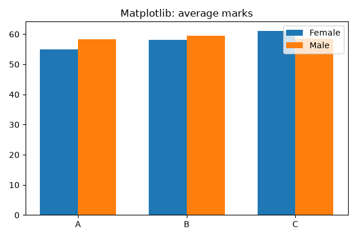
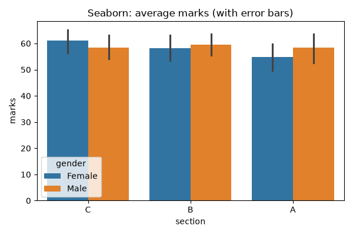
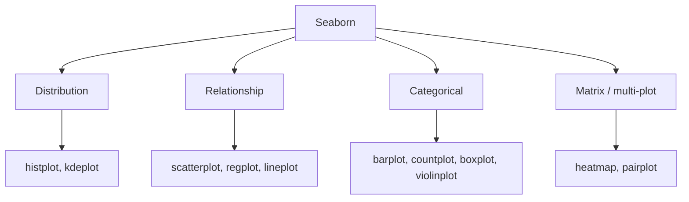
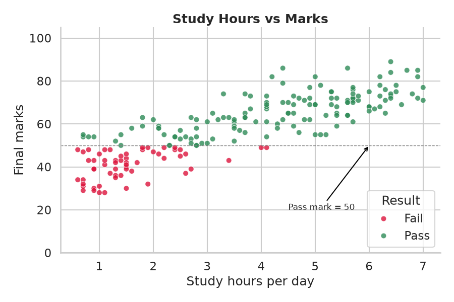
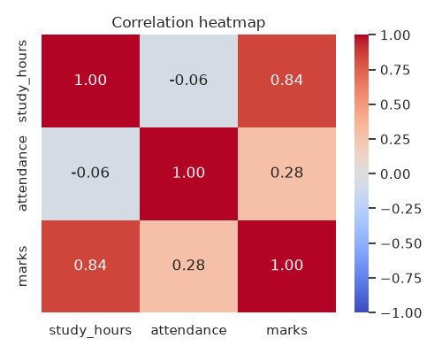

# Session 11: Data Visualization with Seaborn

> Module: Data Science with Python · Diploma in AI · Term 1 · ⏱ ~2 hours

Matplotlib can draw anything, but you often have to calculate averages, position bars and pick colours yourself. **Seaborn** is built on top of Matplotlib and works directly with pandas DataFrames: tell it the column names and it does the statistics, colours and legends for you. In this session you will polish 2-D plots, draw 3-D plots for three variables, and create rich statistical charts with very little code.

> ▶ Run `python make_students_data.py` once (a copy of `students_performance.csv` is already included). It holds 200 students with gender, section, internet, study hours, attendance, marks and result.

## 🎯 Learning Objectives

- Explain how Seaborn differs from Matplotlib and when to use each
- Apply formatting features to 2-D plots: themes, palettes, titles, limits, legends, annotations
- Draw distribution plots: `histplot`, `kdeplot`, `boxplot`, `violinplot`
- Draw relationship and categorical plots: `scatterplot`, `regplot`, `heatmap`, `pairplot`, `countplot`, `barplot`
- Create 3-D scatter and surface plots to show three variables together

## 📖 Concepts Explained

### 1. Seaborn vs Matplotlib

| | Matplotlib | Seaborn |
|---|---|---|
| Level | low-level: full control | high-level: smart defaults |
| Input | lists / arrays | a DataFrame + column names |
| Statistics | you calculate them | done for you (mean, CI, density, regression line) |
| Colour by category | manual loop | `hue="column"` |
| Looks | basic by default | attractive themes out of the box |
| Best use | custom or unusual charts, fine-tuning | fast exploratory analysis |

They work **together**: Seaborn draws, and you can still use Matplotlib commands (`plt.title`, `ax.set_ylim`, `plt.savefig`) to finish the chart.

> **Analogy:** Matplotlib is cooking from raw ingredients; Seaborn is a good recipe kit. You still use the same kitchen (Matplotlib) underneath.

| Matplotlib (manual grouped bars) | Seaborn (one line) |
|---|---|
|  |  |

### 2. The three magic arguments

Almost every Seaborn function accepts:

- `data=df` - which DataFrame
- `x="col"`, `y="col"` - which columns go on the axes
- `hue="col"` - split by a category and colour each group (plus `size=` and `style=` on scatter plots)

### 3. Formatting features of 2-D plots

| Feature | Code |
|---|---|
| Overall theme | `sns.set_theme(style="whitegrid", context="talk")` |
| Colour palette | `palette="Set2"` or a dict `{"Pass": "green", "Fail": "red"}` |
| Title and labels | `ax.set_title(...)`, `ax.set_xlabel(...)` |
| Axis limits | `ax.set_ylim(0, 105)` |
| Reference line | `ax.axhline(50, linestyle="--")` |
| Annotation | `ax.annotate("text", xy=point, xytext=text_position, arrowprops={...})` |
| Legend position | `ax.legend(loc="lower right")` |
| Cleaner borders | `sns.despine()` |
| Sharper image | `plt.savefig("file.png", dpi=150)` |

`context` scales everything for the audience: `paper` < `notebook` < `talk` < `poster`.

### 4. Seaborn chart families



| Function | Shows |
|---|---|
| `histplot(kde=True)` | distribution with a smooth curve |
| `kdeplot(hue=...)` | compare the shape of groups |
| `boxplot`, `violinplot` | spread and outliers per category (violin adds the shape) |
| `regplot` | scatter + best-fit line |
| `heatmap(df.corr(), annot=True)` | correlation matrix as coloured squares |
| `pairplot` | every numeric column vs every other in one grid |
| `countplot` | how many rows per category |
| `barplot` | mean per category with an error bar (confidence interval) |

### 5. Correlation in one line

**Correlation** (−1 to +1) measures how two numeric columns move together: +1 perfectly together, 0 no straight-line link, −1 opposite. A heatmap of `df.corr()` lets you see all pairs at once.

### 6. 3-D plotting for multiple variables

When three numeric variables matter (study hours, attendance, marks) a 3-D axes helps. Create it with `fig.add_subplot(projection="3d")`, then use `scatter(x, y, z)` for points or `plot_surface(X, Y, Z)` for a surface built with `np.meshgrid`.

> Tip: 3-D charts look impressive but are hard to read on paper. Often a 2-D scatter with `hue` or `size` for the third variable communicates better.

## 💻 Code Examples

### Example 1: Matplotlib vs Seaborn

📄 File: [`seaborn_vs_matplotlib.py`](./seaborn_vs_matplotlib.py)

```python
# seaborn_vs_matplotlib.py
# The same question drawn with Matplotlib and with Seaborn.
# Question: average marks per section, split by gender.

import matplotlib
matplotlib.use("Agg")
import matplotlib.pyplot as plt
import numpy as np
import pandas as pd
import seaborn as sns

df = pd.read_csv("students_performance.csv")

# ---- Matplotlib: we must calculate and position everything ourselves ----
table = df.groupby(["section", "gender"])["marks"].mean().unstack()   # sections x genders
x = np.arange(len(table.index))       # bar positions 0, 1, 2
width = 0.35
plt.figure(figsize=(6, 4))
plt.bar(x - width / 2, table["Female"], width, label="Female")
plt.bar(x + width / 2, table["Male"], width, label="Male")
plt.xticks(x, table.index)
plt.title("Matplotlib: average marks")
plt.legend()
plt.tight_layout()
plt.savefig("compare_matplotlib.png")

# ---- Seaborn: one line, works directly on the DataFrame ----
plt.figure(figsize=(6, 4))
sns.barplot(data=df, x="section", y="marks", hue="gender")   # calculates the mean for us
plt.title("Seaborn: average marks (with error bars)")
plt.tight_layout()
plt.savefig("compare_seaborn.png")
print("Saved compare_matplotlib.png and compare_seaborn.png")
```

**How it works:** Matplotlib needs `groupby`, `unstack` and manual bar positions; Seaborn's `barplot` calculates the mean of each section/gender pair and adds error bars automatically.

### Example 2: Formatting a 2-D plot

📄 File: [`plot_formatting.py`](./plot_formatting.py)

```python
# plot_formatting.py
# Formatting features of 2-D plots: themes, palettes, titles, labels, limits, annotations.

import matplotlib
matplotlib.use("Agg")
import matplotlib.pyplot as plt
import pandas as pd
import seaborn as sns

df = pd.read_csv("students_performance.csv")

# 1) Theme and context control the overall look
sns.set_theme(style="whitegrid", context="talk")   # styles: white, dark, whitegrid, darkgrid, ticks

plt.figure(figsize=(9, 6))
ax = sns.scatterplot(
    data=df, x="study_hours", y="marks",
    hue="result",                                  # colour by Pass/Fail
    palette={"Pass": "seagreen", "Fail": "crimson"},
    s=60, alpha=0.8,                               # dot size and transparency
)

# 2) Titles, labels and axis limits
ax.set_title("Study Hours vs Marks", fontsize=18, fontweight="bold")
ax.set_xlabel("Study hours per day")
ax.set_ylabel("Final marks")
ax.set_ylim(0, 105)

# 3) A reference line and an annotation (arrow + text)
ax.axhline(50, color="gray", linestyle="--", linewidth=1)
ax.annotate("Pass mark = 50", xy=(6, 50), xytext=(4.5, 20),
            arrowprops={"arrowstyle": "->", "color": "black"}, fontsize=12)

# 4) Move the legend and remove the top/right borders
ax.legend(title="Result", loc="lower right")
sns.despine()

plt.tight_layout()
plt.savefig("formatted_scatter.png", dpi=100)
print("Saved formatted_scatter.png")
```

**How it works:** the theme sets style and font size, `hue` with a dictionary palette colours pass/fail, and Matplotlib methods on `ax` add the title, limits, pass-mark line and arrow annotation.



### Example 3: Distributions

📄 File: [`seaborn_distributions.py`](./seaborn_distributions.py)

```python
# seaborn_distributions.py
# Looking at the shape of a numeric column: histplot, kdeplot, boxplot, violinplot.

import matplotlib
matplotlib.use("Agg")
import matplotlib.pyplot as plt
import pandas as pd
import seaborn as sns

df = pd.read_csv("students_performance.csv")
sns.set_theme(style="whitegrid")

fig, axes = plt.subplots(2, 2, figsize=(11, 8))

# 1) Histogram with a smooth density curve on top
sns.histplot(data=df, x="marks", bins=20, kde=True, ax=axes[0, 0])
axes[0, 0].set_title("Histogram + KDE of marks")

# 2) KDE (smooth curve) for each gender, to compare shapes
sns.kdeplot(data=df, x="marks", hue="gender", fill=True, ax=axes[0, 1])
axes[0, 1].set_title("Marks density by gender")

# 3) Box plot per section
sns.boxplot(data=df, x="section", y="marks", ax=axes[1, 0])
axes[1, 0].set_title("Box plot of marks by section")

# 4) Violin plot = box plot + density shape
sns.violinplot(data=df, x="internet", y="marks", ax=axes[1, 1])
axes[1, 1].set_title("Marks with / without internet")

fig.tight_layout()
fig.savefig("distributions.png")
print("Saved distributions.png")
```

**How it works:** each Seaborn call receives `ax=` so it draws into one cell of the 2x2 grid. `kde=True` adds a smooth curve and `hue="gender"` overlays two density curves.

### Example 4: Relationships and counts

📄 File: [`seaborn_relationships.py`](./seaborn_relationships.py)

```python
# seaborn_relationships.py
# Relationships between variables: regplot, heatmap and pairplot.

import matplotlib
matplotlib.use("Agg")
import matplotlib.pyplot as plt
import pandas as pd
import seaborn as sns

df = pd.read_csv("students_performance.csv")
sns.set_theme(style="whitegrid")

# 1) Scatter plot with a fitted trend line
plt.figure(figsize=(6, 4))
sns.regplot(data=df, x="attendance", y="marks", scatter_kws={"alpha": 0.5}, line_kws={"color": "red"})
plt.title("Attendance vs Marks with trend line")
plt.tight_layout()
plt.savefig("regplot.png")

# 2) Correlation heatmap of the numeric columns
numbers = df[["study_hours", "attendance", "marks"]]
correlation = numbers.corr()                       # values from -1 to +1
plt.figure(figsize=(5, 4))
sns.heatmap(correlation, annot=True, cmap="coolwarm", vmin=-1, vmax=1, fmt=".2f")
plt.title("Correlation heatmap")
plt.tight_layout()
plt.savefig("heatmap.png")

# 3) Pair plot: every numeric column against every other, coloured by result
grid = sns.pairplot(df, vars=["study_hours", "attendance", "marks"], hue="result", height=2.5)
grid.savefig("pairplot.png")

# 4) Count plot: how many students in each category
plt.figure(figsize=(6, 4))
sns.countplot(data=df, x="section", hue="result")
plt.title("Pass / Fail count per section")
plt.tight_layout()
plt.savefig("countplot.png")
print("Saved regplot.png, heatmap.png, pairplot.png, countplot.png")
```

**How it works:** `regplot` fits a straight line through the points. `df.corr()` creates the correlation table and `heatmap(annot=True)` prints the values in the squares. `pairplot` returns its own figure, so we save it with `grid.savefig`.



### Example 5: 3-D plots

📄 File: [`plot_3d.py`](./plot_3d.py)

```python
# plot_3d.py
# 3-D plots show THREE numeric variables at once (Matplotlib's 3-D toolkit).

import matplotlib
matplotlib.use("Agg")
import matplotlib.pyplot as plt
import numpy as np
import pandas as pd

df = pd.read_csv("students_performance.csv")

fig = plt.figure(figsize=(12, 5))

# 1) 3-D scatter: study hours, attendance and marks
ax1 = fig.add_subplot(1, 2, 1, projection="3d")          # projection="3d" makes a 3-D axes
colours = np.where(df["result"] == "Pass", "green", "red")
ax1.scatter(df["study_hours"], df["attendance"], df["marks"], c=colours, s=15)
ax1.set_xlabel("Study hours")
ax1.set_ylabel("Attendance")
ax1.set_zlabel("Marks")
ax1.set_title("3-D scatter (green = pass)")

# 2) 3-D surface: the "rule" marks = 10 + 6*hours + 0.35*attendance
hours = np.linspace(0.5, 7, 30)
attend = np.linspace(55, 100, 30)
H, A = np.meshgrid(hours, attend)          # every combination of hours and attendance
M = 10 + 6 * H + 0.35 * A
ax2 = fig.add_subplot(1, 2, 2, projection="3d")
ax2.plot_surface(H, A, M, cmap="viridis")
ax2.set_xlabel("Study hours")
ax2.set_ylabel("Attendance")
ax2.set_zlabel("Expected marks")
ax2.set_title("3-D surface")

fig.tight_layout()
fig.savefig("plot_3d.png")
print("Saved plot_3d.png")
```

**How it works:** `projection="3d"` adds a z-axis. The scatter shows real students; `np.meshgrid` builds every combination of hours and attendance so `plot_surface` can draw the formula as a sheet.

## 🧪 Lab Practice

1. Change the theme in `plot_formatting.py` to `darkgrid` and the context to `paper`; compare the images.
2. Draw a `violinplot` of marks by section with `hue="gender"` and `split=True`.
3. Use `sns.lineplot` to show average marks for each value of `attendance` rounded to the nearest 10.
4. Add `size="attendance"` to the scatter plot so dot size shows a third variable.
5. Make a heatmap of the average marks with `section` as rows and `internet` as columns (hint: `pivot_table`).

## 📝 Assignment

Using the `sales.csv` from Session 04 (or any dataset), create a Seaborn report of five saved charts: a histogram with KDE, a box plot by category, a count plot, a correlation heatmap and a pair plot with `hue`. Format every chart (title, labels, theme) and write one insight per chart in a `findings.md` file.

## ❓ Quick Quiz

1. What does the `hue` argument do?
2. Which Seaborn function shows a scatter plot with a best-fit line?
3. Which plot combines a box plot with the shape of the distribution?
4. How do you create a 3-D axes in Matplotlib?
5. A correlation of −0.85 between two columns means what?

<details><summary>Answers</summary>

1. Splits the data by a category column and gives each group its own colour
2. `sns.regplot()` (or `sns.lmplot()`)
3. `sns.violinplot()`
4. `fig.add_subplot(projection="3d")`
5. A strong negative relationship: when one goes up, the other tends to go down

</details>

## 💼 Interview Questions

1. **Why use Seaborn instead of Matplotlib?** It produces statistical plots from DataFrames with less code, handles grouping with `hue`, and has better default styling; Matplotlib is still used for fine control.
2. **What does a pair plot help you discover?** Relationships between every pair of numeric variables and the distribution of each, often coloured by the target class, which is useful before building a model.
3. **Correlation is not causation: explain.** Two variables can move together because of a third factor or coincidence; correlation alone does not prove one causes the other.

## ✅ Summary

- Seaborn = high-level statistical plotting on top of Matplotlib, driven by DataFrame columns.
- `data`, `x`, `y`, `hue` are the core arguments.
- Format with themes, palettes, titles, limits, reference lines and annotations.
- Use distribution, relationship, categorical and matrix plots for different questions.
- 3-D scatter and surface plots show three variables, but use them sparingly.

---

[⬅ Previous](../Session-10-Practice-Lab-Files-Cleaning-and-Charts/README.md) · [🏠 Module Home](../README.md) · [Next ➡](../Session-12-Non-Linear-Regression/README.md)

Prepared by Zeeshan Abbas · Aptech Learning North Nazimabad
