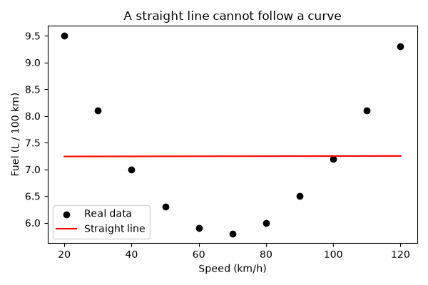
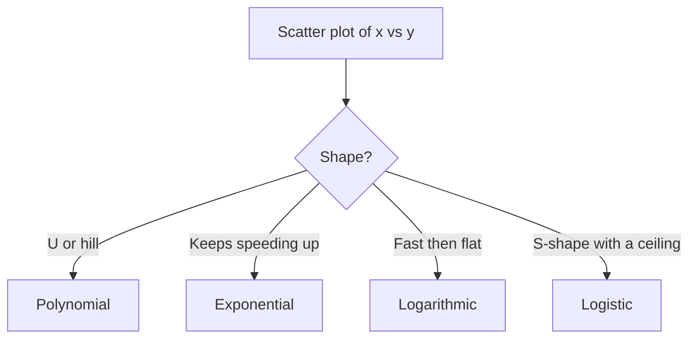
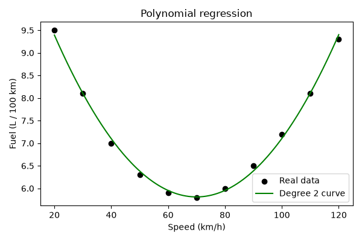
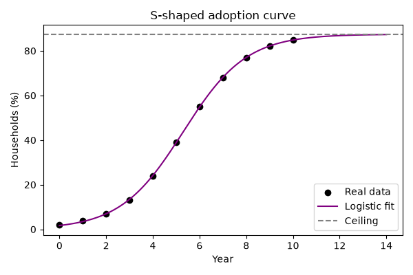

# Session 12: Non-Linear Regression

> Module: Data Science with Python · Diploma in AI · Term 1 · ⏱ ~2 hours

**Regression** means predicting a number: a price, a temperature, a number of users. In the statistics module you met **linear** regression, which fits a straight line. But many things in life follow a **curve**: fuel use is high at very low and very high speeds, app users grow faster and faster, and learning slows down after the first few hours. This session shows how to fit curves with scikit-learn and SciPy and how to choose the right one without overfitting.

## 🎯 Learning Objectives

- Explain what regression is and when a relationship is non-linear
- Describe the important types of non-linear regression: polynomial, exponential, logarithmic and logistic (S-curve)
- Fit a polynomial regression with `PolynomialFeatures` + `LinearRegression`
- Fit any custom curve formula with `scipy.optimize.curve_fit`
- Measure fit quality with R² and detect overfitting with a train/test split

## 📖 Concepts Explained

### 1. Regression in one minute

Regression learns a formula `y = f(x)` from examples, where **x** is the input (feature) and **y** is the number we want to predict (target). Once learned, we can predict y for new x values.

| Linear regression | Non-linear regression |
|---|---|
| `y = a + b·x` (straight line) | the formula bends: `x²`, `eˣ`, `ln(x)`, S-curve |
| constant rate of change | rate of change itself changes |
| salary vs years (roughly) | population growth, fuel vs speed, disease spread |

> **How do you know it is non-linear?** Draw a scatter plot first. If the points clearly bend, or a straight line gives a low R², try a curve.



### 2. Measuring fit: R²

**R² (coefficient of determination)** tells how much of the variation in y the model explains.

| R² | Meaning |
|---|---|
| 1.0 | perfect fit |
| 0.7 - 0.9 | good for most real data |
| around 0 | no better than always predicting the average |
| negative | worse than predicting the average (very bad, often overfitting) |

### 3. Important types of non-linear regression

| Type | Formula | Shape | Typical example |
|---|---|---|---|
| **Polynomial** | `y = a + b·x + c·x² (+ d·x³ ...)` | U-shape, hills and valleys | fuel vs speed, crop yield vs fertiliser |
| **Exponential** | `y = a·e^(b·x)` | grows faster and faster | app users, compound interest, virus spread (early) |
| **Logarithmic** | `y = a + b·ln(x)` | rises fast, then flattens | learning curve, ad spend vs sales |
| **Logistic (S-curve)** | `y = L / (1 + e^(−k(x − x0)))` | slow → fast → ceiling | technology adoption, population with limited resources |
| **Power** | `y = a·x^b` | curved, through origin | metabolism vs body size |



### 4. Polynomial regression: a clever trick

Polynomial regression is still **linear regression**, but on extra columns. `PolynomialFeatures(degree=2)` turns each `x` into `[x, x²]`; a normal `LinearRegression` then finds the best weights. The **degree** controls how bendy the curve can be.

### 5. Curve fitting with SciPy

For exponential, logarithmic or logistic formulas, write the formula as a Python function and let `curve_fit` search for the parameters that make the curve closest to the points (least squares). A sensible starting guess (`p0`) helps it find the answer.

### 6. Overfitting: too much bend

A very high degree can pass through almost every training point, including the random noise, and then predict badly on new data. That is **overfitting**. The opposite, a curve too simple to capture the pattern, is **underfitting**.

| | Underfitting | Good fit | Overfitting |
|---|---|---|---|
| Train score | low | high | very high |
| Test score | low | high | low |
| Example | straight line on a U | degree 2 on a U | degree 15 wiggling through noise |

> **Analogy:** a student who memorises past papers word for word (overfitting) fails when the questions change; a student who understands the concept (good fit) handles new questions.

Always keep some data aside (`train_test_split`) and choose the model with the best **test** score.

## 💻 Code Examples

### Example 1: Straight line on curved data

📄 File: [`linear_vs_nonlinear.py`](./linear_vs_nonlinear.py)

```python
# linear_vs_nonlinear.py
# Why a straight line is not always enough.

import matplotlib
matplotlib.use("Agg")
import matplotlib.pyplot as plt
import numpy as np
from sklearn.linear_model import LinearRegression
from sklearn.metrics import r2_score

# Data: speed of a car (km/h) and fuel used per 100 km.
# Fuel is high at very low AND very high speeds -> a curve (U-shape).
speed = np.array([20, 30, 40, 50, 60, 70, 80, 90, 100, 110, 120])
fuel = np.array([9.5, 8.1, 7.0, 6.3, 5.9, 5.8, 6.0, 6.5, 7.2, 8.1, 9.3])

# 1) Fit a straight line
X = speed.reshape(-1, 1)          # sklearn wants a 2-D table: 11 rows x 1 column
line_model = LinearRegression()
line_model.fit(X, fuel)
line_pred = line_model.predict(X)
print("Straight line R2:", round(r2_score(fuel, line_pred), 3))   # close to 0 = bad fit

# 2) Plot the data and the line
plt.figure(figsize=(6, 4))
plt.scatter(speed, fuel, color="black", label="Real data")
plt.plot(speed, line_pred, color="red", label="Straight line")
plt.title("A straight line cannot follow a curve")
plt.xlabel("Speed (km/h)")
plt.ylabel("Fuel (L / 100 km)")
plt.legend()
plt.tight_layout()
plt.savefig("linear_vs_nonlinear.png")
print("Saved linear_vs_nonlinear.png")
```

**How it works:** `reshape(-1, 1)` turns the list into one column because scikit-learn expects a 2-D table. The line's R² is about 0, proving a straight line explains almost nothing of a U-shaped pattern.

### Example 2: Polynomial regression

📄 File: [`polynomial_regression.py`](./polynomial_regression.py)

```python
# polynomial_regression.py
# Polynomial regression = linear regression on x, x^2, x^3 ... so the line can bend.

import matplotlib
matplotlib.use("Agg")
import matplotlib.pyplot as plt
import numpy as np
from sklearn.linear_model import LinearRegression
from sklearn.metrics import r2_score
from sklearn.preprocessing import PolynomialFeatures

speed = np.array([20, 30, 40, 50, 60, 70, 80, 90, 100, 110, 120])
fuel = np.array([9.5, 8.1, 7.0, 6.3, 5.9, 5.8, 6.0, 6.5, 7.2, 8.1, 9.3])
X = speed.reshape(-1, 1)

# Step 1: create the extra columns x and x^2 (degree 2)
poly = PolynomialFeatures(degree=2, include_bias=False)
X_poly = poly.fit_transform(X)
print("First row before:", X[0], " after:", X_poly[0])   # [20] -> [20, 400]

# Step 2: fit a normal linear regression on the new columns
model = LinearRegression()
model.fit(X_poly, fuel)
print("Intercept:", round(model.intercept_, 3))
print("Coefficients (x, x^2):", model.coef_.round(5))

# Step 3: check how well it fits
pred = model.predict(X_poly)
print("Polynomial R2:", round(r2_score(fuel, pred), 3))   # close to 1 = good fit

# Step 4: predict for a new speed
new_speed = np.array([[65]])
print("Predicted fuel at 65 km/h:", round(model.predict(poly.transform(new_speed))[0], 2))

# Step 5: draw a smooth curve using many x values
smooth_x = np.linspace(20, 120, 200).reshape(-1, 1)
smooth_y = model.predict(poly.transform(smooth_x))
plt.figure(figsize=(6, 4))
plt.scatter(speed, fuel, color="black", label="Real data")
plt.plot(smooth_x, smooth_y, color="green", label="Degree 2 curve")
plt.title("Polynomial regression")
plt.xlabel("Speed (km/h)")
plt.ylabel("Fuel (L / 100 km)")
plt.legend()
plt.tight_layout()
plt.savefig("polynomial_regression.png")
print("Saved polynomial_regression.png")
```

**How it works:** `PolynomialFeatures` adds the `x²` column, then `LinearRegression` fits it. R² jumps to about 0.99. To draw a smooth curve we predict for 200 evenly spaced speeds. New inputs must go through the same `poly.transform` first.



### Example 3: Exponential regression

📄 File: [`exponential_regression.py`](./exponential_regression.py)

```python
# exponential_regression.py
# Exponential growth: y = a * e^(b * x). Example: users of a new app each month.

import matplotlib
matplotlib.use("Agg")
import matplotlib.pyplot as plt
import numpy as np
from scipy.optimize import curve_fit
from sklearn.metrics import r2_score

month = np.array([1, 2, 3, 4, 5, 6, 7, 8])
users = np.array([1200, 1650, 2300, 3100, 4300, 5900, 8200, 11200])

# Step 1: write the formula as a Python function
def exponential(x, a, b):
    return a * np.exp(b * x)

# Step 2: curve_fit finds the best a and b (p0 = starting guess)
params, _ = curve_fit(exponential, month, users, p0=[1000, 0.3])
a, b = params
print(f"Best formula: users = {a:.1f} * e^({b:.3f} * month)")
print("Monthly growth rate:", round((np.exp(b) - 1) * 100, 1), "%")

# Step 3: goodness of fit
pred = exponential(month, a, b)
print("R2:", round(r2_score(users, pred), 4))

# Step 4: forecast the next 2 months
for m in [9, 10]:
    print(f"Forecast month {m}: {exponential(m, a, b):,.0f} users")

# Step 5: plot
smooth = np.linspace(1, 10, 100)
plt.figure(figsize=(6, 4))
plt.scatter(month, users, color="black", label="Real users")
plt.plot(smooth, exponential(smooth, a, b), color="orange", label="Exponential fit")
plt.title("Exponential growth of app users")
plt.xlabel("Month")
plt.ylabel("Users")
plt.legend()
plt.tight_layout()
plt.savefig("exponential_regression.png")
print("Saved exponential_regression.png")
```

**How it works:** the function `exponential(x, a, b)` describes the shape; `curve_fit` returns the best `a` and `b`. `e^b − 1` converts `b` into a monthly growth percentage, and the fitted formula forecasts future months.

### Example 4: Logarithmic regression

📄 File: [`logarithmic_regression.py`](./logarithmic_regression.py)

```python
# logarithmic_regression.py
# Logarithmic curve: y = a + b * ln(x). Fast rise first, then slows down.
# Example: marks improve quickly with the first hours of practice, then level off.

import matplotlib
matplotlib.use("Agg")
import matplotlib.pyplot as plt
import numpy as np
from scipy.optimize import curve_fit
from sklearn.metrics import r2_score

practice_hours = np.array([1, 2, 4, 6, 8, 12, 16, 20, 25, 30])
score = np.array([35, 47, 58, 64, 68, 73, 77, 79, 81, 83])

def logarithmic(x, a, b):
    return a + b * np.log(x)        # np.log = natural log (ln)

params, _ = curve_fit(logarithmic, practice_hours, score)
a, b = params
print(f"Best formula: score = {a:.2f} + {b:.2f} * ln(hours)")
print("R2:", round(r2_score(score, logarithmic(practice_hours, a, b)), 4))
print("Predicted score after 40 hours:", round(logarithmic(40, a, b), 1))

smooth = np.linspace(1, 40, 200)
plt.figure(figsize=(6, 4))
plt.scatter(practice_hours, score, color="black", label="Real scores")
plt.plot(smooth, logarithmic(smooth, a, b), color="blue", label="Log fit")
plt.title("Diminishing returns of practice")
plt.xlabel("Practice hours")
plt.ylabel("Score")
plt.legend()
plt.tight_layout()
plt.savefig("logarithmic_regression.png")
print("Saved logarithmic_regression.png")
```

**How it works:** `np.log` is the natural log. The fitted curve rises quickly at first and flattens, showing diminishing returns from extra practice.

### Example 5: Logistic (S-curve) growth

📄 File: [`logistic_growth.py`](./logistic_growth.py)

```python
# logistic_growth.py
# Logistic (S-shaped) curve: slow start, fast middle, then a ceiling.
# y = L / (1 + e^(-k * (x - x0)))   L = ceiling, k = steepness, x0 = middle point
# Example: % of households in a town with a new internet service over the years.

import matplotlib
matplotlib.use("Agg")
import matplotlib.pyplot as plt
import numpy as np
from scipy.optimize import curve_fit

year = np.array([0, 1, 2, 3, 4, 5, 6, 7, 8, 9, 10])
percent = np.array([2, 4, 7, 13, 24, 39, 55, 68, 77, 82, 85])

def logistic(x, L, k, x0):
    return L / (1 + np.exp(-k * (x - x0)))

params, _ = curve_fit(logistic, year, percent, p0=[90, 1, 5])
L, k, x0 = params
print(f"Ceiling L = {L:.1f}%  steepness k = {k:.2f}  middle year x0 = {x0:.1f}")
print("Predicted % in year 12:", round(logistic(12, L, k, x0), 1))

smooth = np.linspace(0, 14, 200)
plt.figure(figsize=(6, 4))
plt.scatter(year, percent, color="black", label="Real data")
plt.plot(smooth, logistic(smooth, L, k, x0), color="purple", label="Logistic fit")
plt.axhline(L, color="gray", linestyle="--", label="Ceiling")
plt.title("S-shaped adoption curve")
plt.xlabel("Year")
plt.ylabel("Households (%)")
plt.legend()
plt.tight_layout()
plt.savefig("logistic_growth.png")
print("Saved logistic_growth.png")
```

**How it works:** three parameters are found: the ceiling `L`, the steepness `k` and the middle year `x0`. Predictions never go above the ceiling, which is realistic for adoption data.



### Example 6: Choosing the degree

📄 File: [`choose_degree.py`](./choose_degree.py)

```python
# choose_degree.py
# How bendy should the curve be? Test different polynomial degrees on unseen data.

import numpy as np
from sklearn.linear_model import LinearRegression
from sklearn.metrics import r2_score
from sklearn.model_selection import train_test_split
from sklearn.preprocessing import PolynomialFeatures

# Make 60 noisy points that follow a gentle curve
rng = np.random.default_rng(seed=0)
x = rng.uniform(0, 10, 60)
y = 3 + 2 * x - 0.15 * x**2 + rng.normal(0, 1, 60)
X = x.reshape(-1, 1)

# Keep 30% of points aside to test the model on data it has never seen
X_train, X_test, y_train, y_test = train_test_split(X, y, test_size=0.3, random_state=1)

print("Degree   Train R2   Test R2")
for degree in [1, 2, 3, 4, 6]:
    poly = PolynomialFeatures(degree=degree, include_bias=False)
    model = LinearRegression()
    model.fit(poly.fit_transform(X_train), y_train)
    train_r2 = r2_score(y_train, model.predict(poly.transform(X_train)))
    test_r2 = r2_score(y_test, model.predict(poly.transform(X_test)))
    print(f"{degree:>6}   {train_r2:8.3f}   {test_r2:7.3f}")

print("\nLook for the degree with the best TEST score, not the best train score.")
print("High train but lower test = overfitting (the curve memorised the noise).")
```

**How it works:** for each degree we train on 70% of the points and test on the other 30%. Train R² keeps rising with degree, but test R² peaks at degree 2 and then falls (even below zero), which is overfitting.

## 🧪 Lab Practice

1. In `polynomial_regression.py`, try degree 3 and degree 5. Does R² improve much? Is the curve still sensible outside 20-120 km/h?
2. Fit a straight line to the app-users data in Example 3 and compare its R² with the exponential fit.
3. Change the logistic data so the ceiling is around 60% and re-fit. Check the new value of `L`.
4. Create data for house price vs size where price rises faster for bigger houses and fit a degree-2 polynomial.
5. In `choose_degree.py`, change `test_size` to 0.5 and see whether the best degree changes.

## 📝 Assignment

Find (or create) a dataset of Pakistan's population or mobile-internet users over at least 10 years. Plot it, fit both an exponential and a logistic curve, report each R², forecast the next 3 years with both, and explain in comments which model you trust more and why.

## ❓ Quick Quiz

1. When should you consider non-linear regression?
2. What does `PolynomialFeatures(degree=2)` do to the value 3?
3. Which curve type has a maximum ceiling?
4. What does a negative R² on the test set suggest?
5. Which SciPy function fits a custom formula to data?

<details><summary>Answers</summary>

1. When a scatter plot shows a curved pattern or a straight line fits poorly
2. Turns it into `[3, 9]` (x and x²)
3. Logistic (S-curve)
4. The model is worse than predicting the average, usually overfitting or a wrong model
5. `scipy.optimize.curve_fit`

</details>

## 💼 Interview Questions

1. **Is polynomial regression a linear or non-linear model?** It produces a non-linear curve in x, but it is linear in its coefficients, so it is solved with ordinary linear regression on polynomial features.
2. **How do you prevent overfitting in polynomial regression?** Use a lower degree, more data, a train/test split or cross-validation to pick the degree, and regularisation (Ridge/Lasso).
3. **Difference between exponential and logistic growth?** Exponential growth keeps accelerating forever; logistic growth slows down and levels off at a ceiling (carrying capacity).

## ✅ Summary

- Non-linear regression fits curves when the relationship bends.
- Key types: polynomial, exponential, logarithmic, logistic (and power).
- Polynomial = `PolynomialFeatures` + `LinearRegression`; other curves = `curve_fit`.
- Judge with R² on **test** data; too high a degree overfits.
- Always plot the data and the fitted curve.

---

[⬅ Previous](../Session-11-Data-Visualization-with-Seaborn/README.md) · [🏠 Module Home](../README.md) · [Next ➡](../Session-13-Practice-Lab-Seaborn-and-Regression/README.md)

Prepared by Zeeshan Abbas · Aptech Learning North Nazimabad
