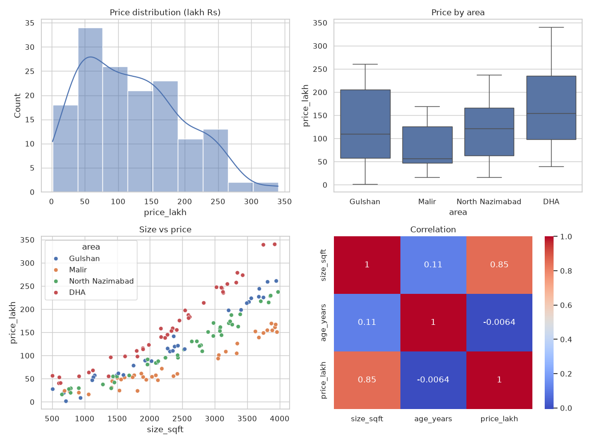
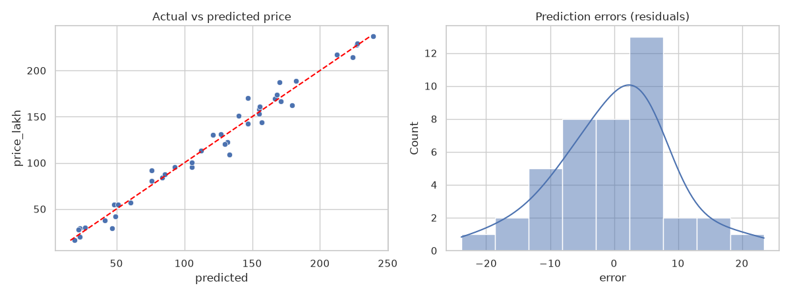

# Session 13: Practice Lab - Seaborn and Regression

> Module: Data Science with Python · Diploma in AI · Term 1 · ⏱ ~2 hours

This lab revises Sessions 11 and 12. You will play the role of an analyst at a Karachi property portal: explore house prices with Seaborn, predict prices with polynomial regression, compare two growth curves for a housing society's electricity demand, and check your model visually. Try each task first, then compare with the solution file.

> ▶ `house_prices.csv` (150 houses: size, area, age, price in lakh Rs) is included. Recreate it any time with `python make_house_data.py`.

## 🎯 Learning Objectives

- Explore a new dataset quickly with Seaborn distribution, categorical, relationship and heatmap plots
- Choose a polynomial degree using a train/test split
- Fit and compare exponential and logistic curves with `curve_fit`
- Evaluate a regression model with an actual-vs-predicted plot and residuals
- Explain results in plain business language

## 📖 Concepts Explained

### 1. Lab workflow


### 2. Revision: which Seaborn plot?

| Question | Plot |
|---|---|
| How are prices spread? | `histplot(kde=True)` |
| Which area is most expensive? | `boxplot(x="area", y="price_lakh")` |
| Does price curve with size? | `scatterplot(hue="area")` |
| Which numbers move together? | `heatmap(df.corr(), annot=True)` |

### 3. Revision: regression toolkit

| Need | Tool |
|---|---|
| Bend a line | `PolynomialFeatures(degree=n)` + `LinearRegression` |
| Custom formula | `curve_fit(func, x, y, p0=[...])` |
| Fair evaluation | `train_test_split(..., test_size=0.3)` |
| Score | `r2_score(actual, predicted)` |
| Unpack fitted parameters | `func(x, *params)` |

### 4. Simpler is better when scores tie

If degree 3 scores almost the same as degree 2 on test data, choose **degree 2**. Simpler models are easier to explain and less likely to fail on new data. This idea is called **Occam's razor**. Task 2 only accepts a more complex model when it is clearly better.

### 5. Residuals: the model's mistakes

A **residual** = actual − predicted. For a good model:

- points in an actual-vs-predicted plot lie close to the diagonal line,
- residuals are centred on zero and look random (no pattern),
- a clear pattern in residuals means the model is missing something (e.g. needs a curve or another feature).

> **Analogy:** a tailor's measurements are good if errors are small and random. If every shirt is too short, there is a system error (a missing feature), not bad luck.

## 💻 Code Examples

### Task 1 (Session 11): Explore with Seaborn

📄 File: [`task1_explore_seaborn.py`](./task1_explore_seaborn.py)

```python
# task1_explore_seaborn.py  (Practice for Session 11)
# Task: explore house_prices.csv with four Seaborn charts in one figure.

import matplotlib
matplotlib.use("Agg")
import matplotlib.pyplot as plt
import pandas as pd
import seaborn as sns

df = pd.read_csv("house_prices.csv")
sns.set_theme(style="whitegrid")

fig, axes = plt.subplots(2, 2, figsize=(12, 9))

# Step 1: distribution of price
sns.histplot(data=df, x="price_lakh", kde=True, ax=axes[0, 0])
axes[0, 0].set_title("Price distribution (lakh Rs)")

# Step 2: price by area
sns.boxplot(data=df, x="area", y="price_lakh", ax=axes[0, 1])
axes[0, 1].set_title("Price by area")

# Step 3: size vs price coloured by area -> does it curve?
sns.scatterplot(data=df, x="size_sqft", y="price_lakh", hue="area", ax=axes[1, 0])
axes[1, 0].set_title("Size vs price")

# Step 4: correlation heatmap
sns.heatmap(df[["size_sqft", "age_years", "price_lakh"]].corr(), annot=True, cmap="coolwarm", ax=axes[1, 1])
axes[1, 1].set_title("Correlation")

fig.tight_layout()
fig.savefig("house_explore.png")
print("Saved house_explore.png")
print("Average price per area:\n", df.groupby("area")["price_lakh"].mean().round(1).sort_values())
```

**How it works:** four Seaborn plots go into a 2x2 grid with `ax=`. The scatter coloured by area shows a curve that rises faster for bigger houses, which hints at polynomial regression.



### Task 2 (Session 12): Choose the polynomial degree

📄 File: [`task2_polynomial_price.py`](./task2_polynomial_price.py)

```python
# task2_polynomial_price.py  (Practice for Session 12)
# Task: predict price from size. Compare degree 1, 2 and 3 on test data.

import pandas as pd
from sklearn.linear_model import LinearRegression
from sklearn.metrics import r2_score
from sklearn.model_selection import train_test_split
from sklearn.preprocessing import PolynomialFeatures

df = pd.read_csv("house_prices.csv")
df = df[df["area"] == "North Nazimabad"]      # one area, so size is the main factor
X = df[["size_sqft"]]                          # double brackets -> 2-D table
y = df["price_lakh"]

X_train, X_test, y_train, y_test = train_test_split(X, y, test_size=0.3, random_state=42)

best_degree, best_score = None, -999
for degree in [1, 2, 3]:
    poly = PolynomialFeatures(degree=degree, include_bias=False)
    model = LinearRegression()
    model.fit(poly.fit_transform(X_train), y_train)
    score = r2_score(y_test, model.predict(poly.transform(X_test)))
    print(f"Degree {degree}: test R2 = {score:.3f}")
    # accept a more complex (higher degree) model only if it is clearly better
    if score > best_score + 0.005:
        best_degree, best_score = degree, score

print("\nBest degree:", best_degree)

# Refit the best model and predict a 2,500 sq ft house
poly = PolynomialFeatures(degree=best_degree, include_bias=False)
model = LinearRegression().fit(poly.fit_transform(X), y)
new_house = pd.DataFrame({"size_sqft": [2500]})
print("Predicted price for 2,500 sq ft:", round(model.predict(poly.transform(new_house))[0], 1), "lakh")
```

**How it works:** we use one area so size is the main driver, split 70/30, and compare test R² for degrees 1-3. A higher degree is accepted only if clearly better. The final model is refitted on all rows and used for a prediction.

### Task 3 (Session 12): Exponential vs logistic

📄 File: [`task3_curve_fit_demand.py`](./task3_curve_fit_demand.py)

```python
# task3_curve_fit_demand.py  (Practice for Session 12)
# Task: electricity demand of a growing housing society. Fit exponential AND logistic, compare.

import numpy as np
from scipy.optimize import curve_fit
from sklearn.metrics import r2_score

year = np.arange(0, 12)
demand_mw = np.array([5, 6.5, 8.6, 11.2, 14.5, 18.3, 22.4, 26.0, 28.9, 30.8, 32.0, 32.7])

def exponential(x, a, b):
    return a * np.exp(b * x)

def logistic(x, L, k, x0):
    return L / (1 + np.exp(-k * (x - x0)))

exp_params, _ = curve_fit(exponential, year, demand_mw, p0=[5, 0.2])
log_params, _ = curve_fit(logistic, year, demand_mw, p0=[35, 0.5, 5])

exp_r2 = r2_score(demand_mw, exponential(year, *exp_params))   # *params unpacks the list
log_r2 = r2_score(demand_mw, logistic(year, *log_params))
print("Exponential R2:", round(exp_r2, 3))
print("Logistic    R2:", round(log_r2, 3))

print("\nForecast for year 15:")
print("  Exponential:", round(exponential(15, *exp_params), 1), "MW")
print("  Logistic:   ", round(logistic(15, *log_params), 1), "MW")
print("\nThe demand is levelling off, so the logistic model is more realistic.")
```

**How it works:** both formulas are fitted to the same data. The logistic curve has the higher R² and a sensible forecast because demand is clearly levelling off; the exponential model would wildly over-predict.

### Task 4 (Sessions 11 + 12): Actual vs predicted

📄 File: [`task4_actual_vs_predicted.py`](./task4_actual_vs_predicted.py)

```python
# task4_actual_vs_predicted.py  (Practice for Sessions 11 + 12)
# Task: visualise how good a degree-2 model is, using Seaborn.

import matplotlib
matplotlib.use("Agg")
import matplotlib.pyplot as plt
import pandas as pd
import seaborn as sns
from sklearn.linear_model import LinearRegression
from sklearn.preprocessing import PolynomialFeatures

df = pd.read_csv("house_prices.csv")
df = df[df["area"] == "North Nazimabad"].copy()

poly = PolynomialFeatures(degree=2, include_bias=False)
X_poly = poly.fit_transform(df[["size_sqft"]])
model = LinearRegression().fit(X_poly, df["price_lakh"])

df["predicted"] = model.predict(X_poly)
df["error"] = df["price_lakh"] - df["predicted"]     # residual = actual - predicted

sns.set_theme(style="whitegrid")
fig, axes = plt.subplots(1, 2, figsize=(12, 4.5))

# Left: actual vs predicted. Perfect predictions sit on the diagonal line.
sns.scatterplot(data=df, x="predicted", y="price_lakh", ax=axes[0])
low, high = df["price_lakh"].min(), df["price_lakh"].max()
axes[0].plot([low, high], [low, high], color="red", linestyle="--")
axes[0].set_title("Actual vs predicted price")

# Right: errors should be scattered randomly around zero
sns.histplot(data=df, x="error", kde=True, ax=axes[1])
axes[1].set_title("Prediction errors (residuals)")

fig.tight_layout()
fig.savefig("actual_vs_predicted.png")
print("Saved actual_vs_predicted.png")
print("Average absolute error:", round(df["error"].abs().mean(), 2), "lakh")
```

**How it works:** we store predictions and residuals as new columns, draw actual vs predicted with a red diagonal for "perfect", and a histogram of residuals that should centre on zero.



## 🧪 Lab Practice

1. Add a `violinplot` of price by area to Task 1 and describe the difference from the box plot.
2. Repeat Task 2 for the DHA area. Is the best degree the same?
3. In Task 2, add `age_years` as a second feature (`X = df[["size_sqft", "age_years"]]`) and compare test R².
4. In Task 3, plot both fitted curves and the real points on one chart up to year 15.
5. In Task 4, draw a scatter plot of `size_sqft` vs `error`. Do you see any pattern?

## 📝 Assignment

Create a dataset of 50 used cars (`age_years`, `mileage_km`, `price_lakh`) where price falls quickly in the first years and then slowly. Explore it with three Seaborn charts, fit linear, polynomial (degree 2) and an exponential-decay curve `a * e^(-b*x)` on age, compare test R², and save an actual-vs-predicted chart for the best model.

## ❓ Quick Quiz

1. Which Seaborn function quickly shows correlations between all numeric columns?
2. Why do we use only one area in Task 2?
3. Two degrees give test R² of 0.949 and 0.950. Which do you choose and why?
4. What is a residual?
5. Why did the logistic model give a lower year-15 forecast than the exponential model?

<details><summary>Answers</summary>

1. `sns.heatmap(df.corr(), annot=True)`
2. Area also changes price; fixing it lets size be the main factor so the curve is clear
3. The lower degree, because it is simpler and almost equally accurate
4. Actual value minus predicted value (the model's error)
5. The logistic curve has a ceiling and the data is levelling off; exponential keeps growing forever

</details>

## 💼 Interview Questions

1. **How do you check whether a regression model is good beyond R²?** Look at residual plots, actual-vs-predicted plots, error metrics like MAE/RMSE, and performance on a held-out test set.
2. **What does a pattern in residuals indicate?** The model is missing structure, such as a non-linear relationship, an important feature or interaction.
3. **How do you choose between two curve models?** Compare test performance and check whether the model's behaviour (e.g. a ceiling) makes sense for the real-world process.

## ✅ Summary

- Explore with Seaborn first; the scatter plot often reveals a curve.
- Pick the polynomial degree by test R², preferring simpler models on ties.
- Compare custom curves with `curve_fit` and choose the one that fits reality.
- Residual and actual-vs-predicted plots reveal how and where a model fails.

---

[⬅ Previous](../Session-12-Non-Linear-Regression/README.md) · [🏠 Module Home](../README.md) · [Next ➡](../Session-14-Classification-KNN-and-SVM/README.md)

Prepared by Zeeshan Abbas · Aptech Learning North Nazimabad
