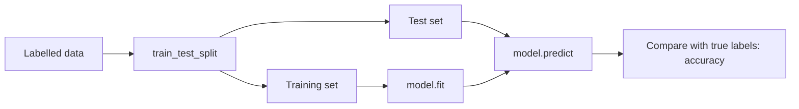
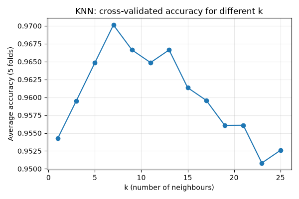
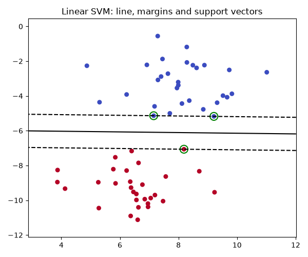

# Session 14: Classification I - K-Nearest Neighbours and Support Vector Machines

> Module: Data Science with Python · Diploma in AI · Term 1 · ⏱ ~2 hours

Is this email spam or not? Will this customer repay the loan? Is this tumour benign or malignant? These are **classification** problems: the answer is a **category**, not a number. In this session you will learn the vocabulary of classification and two classic algorithms: **K-Nearest Neighbours (KNN)**, which decides by looking at similar examples, and **Support Vector Machines (SVM)**, which draws the best possible boundary between classes.

## 🎯 Learning Objectives

- Describe classification and how it differs from regression
- Use the terms features, labels, training set, test set and accuracy correctly
- Explain how KNN works, including distance, `k` and the need for scaling
- Explain how SVM works: hyperplane, margin, support vectors, `C` and kernels
- Train, test and tune KNN and SVM models with scikit-learn

## 📖 Concepts Explained

### 1. What is classification?

**Classification** is supervised learning where the model learns from examples with known labels and then predicts the label of new examples.

| | Regression (Session 12) | Classification |
|---|---|---|
| Output | a number | a category |
| Example | house price = 110 lakh | email = "spam" |
| Measure | R², error | accuracy, precision, recall |

| Type | Number of classes | Example |
|---|---|---|
| Binary | 2 | pass/fail, fraud/not fraud |
| Multi-class | 3 or more | iris species, digit 0-9 |

### 2. The classification vocabulary

| Term | Meaning | In our student example |
|---|---|---|
| **Feature (X)** | input column | study hours, attendance |
| **Label / target (y)** | the answer to predict | Pass / Fail |
| **Training set** | rows the model learns from | ~70-80% of data |
| **Test set** | unseen rows used to check the model | ~20-30% of data |
| **Accuracy** | correct predictions ÷ all predictions | 27 / 30 = 90% |



Every scikit-learn model follows the same three steps: **create** → `fit(X_train, y_train)` → `predict(X_test)`.

### 3. K-Nearest Neighbours (KNN)

> **Analogy:** You move to a new neighbourhood and want to guess which cricket team a house supports. You ask the 5 nearest houses; if 4 support Karachi Kings, you guess Karachi Kings.

Algorithm for a new point:

1. Measure the **distance** to every training point (usually straight-line, called Euclidean distance).
2. Pick the **k** closest points.
3. **Vote**: the most common label wins.

| Choice | Effect |
|---|---|
| Small k (1-3) | very sensitive to noise, can overfit |
| Large k | smoother, may ignore local patterns (underfit) |
| Odd k | avoids ties in binary problems |
| **Scaling** | essential, otherwise big-range features (grams, rupees) dominate distance |

KNN is a **lazy learner**: `fit` just stores the data; all the work happens at prediction time, so it gets slow with very large datasets.

### 4. Support Vector Machines (SVM)

> **Analogy:** Two groups of students stand in a field. You want to paint a road between them that is **as wide as possible** without touching anyone. The students standing at the edge of the road are the **support vectors**; they alone decide where the road goes.

| Term | Meaning |
|---|---|
| **Hyperplane** | the boundary (a line in 2-D, a plane in 3-D) |
| **Margin** | distance between the boundary and the nearest points; SVM makes it as wide as possible |
| **Support vectors** | the training points closest to the boundary |
| **C** | penalty for mistakes: small C = wide margin, tolerates errors; large C = strict, risk of overfitting |
| **Kernel** | a trick to separate data that is not linearly separable by imagining it in higher dimensions |

| Kernel | Use when |
|---|---|
| `linear` | classes split by a straight line; many features (e.g. text) |
| `poly` | curved boundaries of a known degree |
| `rbf` (default) | complex curved boundaries; good first choice |

### 5. Cross-validation

One random train/test split can be lucky or unlucky. **k-fold cross-validation** splits the data into k parts, tests on each part once, and averages the scores, giving a more reliable estimate for choosing `k` in KNN or `C` in SVM.

### 6. KNN vs SVM

| | KNN | SVM |
|---|---|---|
| Idea | similar points share labels | widest separating boundary |
| Training | instant (stores data) | slower (optimisation) |
| Prediction | slow on big data | fast |
| Key settings | `n_neighbors` | `kernel`, `C`, `gamma` |
| Needs scaling | yes | yes |

## 💻 Code Examples

### Example 1: Classification vocabulary

📄 File: [`classification_basics.py`](./classification_basics.py)

```python
# classification_basics.py
# Classification = predict a CATEGORY (label), e.g. "Pass" or "Fail".
# This file shows the vocabulary: features, labels, train set, test set.

import pandas as pd
from sklearn.model_selection import train_test_split

# A tiny dataset: hours studied and attendance -> result
data = pd.DataFrame({
    "study_hours": [1, 2, 2.5, 3, 4, 5, 5.5, 6, 1.5, 3.5, 4.5, 0.5],
    "attendance":  [60, 65, 70, 75, 80, 90, 92, 95, 55, 78, 85, 50],
    "result":      ["Fail", "Fail", "Fail", "Pass", "Pass", "Pass",
                    "Pass", "Pass", "Fail", "Pass", "Pass", "Fail"],
})

# 1) Features (X) = the inputs.  Label (y) = what we want to predict.
X = data[["study_hours", "attendance"]]
y = data["result"]
print("Features:\n", X.head(3))
print("Labels:", y.unique())
print("How many of each class:\n", y.value_counts())

# 2) Split: the model learns from the TRAIN part and is checked on the TEST part
X_train, X_test, y_train, y_test = train_test_split(
    X, y, test_size=0.25, random_state=0, stratify=y   # stratify keeps the class mix equal
)
print("\nTrain rows:", len(X_train), " Test rows:", len(X_test))

# 3) A hand-made "model": a simple rule
def simple_rule(hours, attendance):
    if hours >= 3 and attendance >= 70:
        return "Pass"
    return "Fail"

predictions = [simple_rule(h, a) for h, a in zip(X_test["study_hours"], X_test["attendance"])]
print("\nTest actual:     ", list(y_test))
print("Rule predictions:", predictions)
correct = sum(p == a for p, a in zip(predictions, y_test))
print("Accuracy:", correct, "/", len(y_test))
```

**How it works:** we separate features from the label, split with `stratify=y` so both sets keep the same Pass/Fail mix, and test a hand-written rule. A machine learning model simply learns such a rule from data.

### Example 2: KNN by hand

📄 File: [`knn_by_hand.py`](./knn_by_hand.py)

```python
# knn_by_hand.py
# K-Nearest Neighbours explained with plain Python: "tell me who your neighbours are".

import math

# Known fruits: (weight in grams, sweetness 1-10) -> label
known = [
    (150, 7, "Apple"), (170, 8, "Apple"), (140, 6, "Apple"),
    (120, 9, "Mango"), (200, 9, "Mango"), (220, 10, "Mango"),
    (80, 3, "Lemon"), (90, 2, "Lemon"), (70, 3, "Lemon"),
]
new_fruit = (160, 8)    # we don't know what this is
k = 3

# Step 1: distance from the new fruit to every known fruit (straight-line distance)
distances = []
for weight, sweet, label in known:
    d = math.sqrt((weight - new_fruit[0]) ** 2 + (sweet - new_fruit[1]) ** 2)
    distances.append((d, label))

# Step 2: sort by distance and keep the k closest
distances.sort()
nearest = distances[:k]
print("The", k, "nearest neighbours:")
for d, label in nearest:
    print(f"   {label:<6} distance {d:.1f}")

# Step 3: majority vote
votes = {}
for d, label in nearest:
    votes[label] = votes.get(label, 0) + 1
prediction = max(votes, key=votes.get)
print("Votes:", votes, "-> prediction:", prediction)
# Note: weight (grams) has a much bigger range than sweetness, so it dominates the distance.
# That is why we SCALE features before KNN (see knn_sklearn.py).
```

**How it works:** distances are calculated with Pythagoras' formula, sorted, and the 3 nearest labels vote. The comment shows why scaling matters: weight in grams dwarfs sweetness.

### Example 3: KNN with scikit-learn

📄 File: [`knn_sklearn.py`](./knn_sklearn.py)

```python
# knn_sklearn.py
# KNN with scikit-learn on the famous Iris flower dataset (comes with sklearn).

from sklearn.datasets import load_iris
from sklearn.metrics import accuracy_score
from sklearn.model_selection import train_test_split
from sklearn.neighbors import KNeighborsClassifier
from sklearn.preprocessing import StandardScaler

# 1) Load data: 150 flowers, 4 measurements, 3 species
iris = load_iris()
X, y = iris.data, iris.target
print("Features:", iris.feature_names)
print("Classes:", iris.target_names.tolist())

# 2) Split into train and test
X_train, X_test, y_train, y_test = train_test_split(X, y, test_size=0.3, random_state=42, stratify=y)

# 3) Scale: learn mean/std from TRAIN only, apply to both
scaler = StandardScaler()
X_train_scaled = scaler.fit_transform(X_train)
X_test_scaled = scaler.transform(X_test)

# 4) Create and train the model (k = 5 neighbours)
knn = KNeighborsClassifier(n_neighbors=5)
knn.fit(X_train_scaled, y_train)

# 5) Predict and measure accuracy
predictions = knn.predict(X_test_scaled)
print("\nAccuracy:", round(accuracy_score(y_test, predictions), 3))

# 6) Predict a brand-new flower
new_flower = [[5.9, 3.0, 5.1, 1.8]]   # sepal length, sepal width, petal length, petal width
species = knn.predict(scaler.transform(new_flower))[0]
print("New flower is:", iris.target_names[species])
```

**How it works:** the scaler learns from the training set only, then transforms both sets. `KNeighborsClassifier(n_neighbors=5)` is fitted and evaluated with `accuracy_score`. New data must be scaled the same way before predicting.

### Example 4: Choosing k

📄 File: [`choose_k.py`](./choose_k.py)

```python
# choose_k.py
# Which k works best for KNN? Try several values with 5-fold cross-validation.

import matplotlib
matplotlib.use("Agg")
import matplotlib.pyplot as plt
from sklearn.datasets import load_breast_cancer
from sklearn.model_selection import cross_val_score
from sklearn.neighbors import KNeighborsClassifier
from sklearn.pipeline import make_pipeline
from sklearn.preprocessing import StandardScaler

# Breast cancer dataset: 569 patients, 30 measurements, label = malignant / benign
X, y = load_breast_cancer(return_X_y=True)

k_values = list(range(1, 26, 2))    # odd numbers avoid ties in voting
scores = []
for k in k_values:
    # pipeline = scale first, then KNN (scaling is re-learned inside every fold)
    model = make_pipeline(StandardScaler(), KNeighborsClassifier(n_neighbors=k))
    # cross-validation: split data into 5 parts, test on each part once, average the 5 scores
    cv_scores = cross_val_score(model, X, y, cv=5)
    scores.append(cv_scores.mean())
    print(f"k = {k:>2}  average accuracy = {cv_scores.mean():.3f}")

best_k = k_values[scores.index(max(scores))]
print("\nBest k:", best_k)

plt.figure(figsize=(6, 4))
plt.plot(k_values, scores, marker="o")
plt.title("KNN: cross-validated accuracy for different k")
plt.xlabel("k (number of neighbours)")
plt.ylabel("Average accuracy (5 folds)")
plt.grid(True, alpha=0.3)
plt.tight_layout()
plt.savefig("choose_k.png")
print("Saved choose_k.png")
```

**How it works:** `make_pipeline` bundles scaling and KNN so cross-validation scales correctly inside each fold. We average 5 fold scores for every odd k and plot them; the peak is the best k.



### Example 5: Linear SVM

📄 File: [`svm_linear.py`](./svm_linear.py)

```python
# svm_linear.py
# Support Vector Machine: find the widest "street" that separates two classes.

import matplotlib
matplotlib.use("Agg")
import matplotlib.pyplot as plt
import numpy as np
from sklearn.datasets import make_blobs
from sklearn.svm import SVC

# 1) Two groups of points that can be separated by a straight line
X, y = make_blobs(n_samples=60, centers=2, random_state=6, cluster_std=1.2)

# 2) Linear SVM
model = SVC(kernel="linear", C=1.0)
model.fit(X, y)
print("Number of support vectors per class:", model.n_support_)
print("Prediction for point (6, -6):", model.predict([[6, -6]])[0])

# 3) Draw points, the separating line and the margins
plt.figure(figsize=(6, 5))
plt.scatter(X[:, 0], X[:, 1], c=y, cmap="coolwarm", s=30)

# make a grid over the plot and ask the model how far each grid point is from the line
xx, yy = np.meshgrid(np.linspace(X[:, 0].min() - 1, X[:, 0].max() + 1, 200),
                     np.linspace(X[:, 1].min() - 1, X[:, 1].max() + 1, 200))
grid = np.c_[xx.ravel(), yy.ravel()]
distance = model.decision_function(grid).reshape(xx.shape)
plt.contour(xx, yy, distance, levels=[-1, 0, 1], colors="black", linestyles=["--", "-", "--"])

# circle the support vectors
sv = model.support_vectors_
plt.scatter(sv[:, 0], sv[:, 1], s=120, facecolors="none", edgecolors="green", linewidths=1.5)
plt.title("Linear SVM: line, margins and support vectors")
plt.tight_layout()
plt.savefig("svm_linear.png")
print("Saved svm_linear.png")
```

**How it works:** `SVC(kernel="linear")` finds the separating line. `decision_function` measures how far each grid point is from it, so `contour` can draw the line (0) and margins (−1, +1). Green circles mark the support vectors.



### Example 6: Kernels and C

📄 File: [`svm_kernels.py`](./svm_kernels.py)

```python
# svm_kernels.py
# When classes are NOT separable by a straight line, the kernel trick helps.

from sklearn.datasets import make_moons
from sklearn.metrics import accuracy_score
from sklearn.model_selection import train_test_split
from sklearn.preprocessing import StandardScaler
from sklearn.svm import SVC

# Two interleaving half-moons: impossible to split with one straight line
X, y = make_moons(n_samples=300, noise=0.2, random_state=0)
X_train, X_test, y_train, y_test = train_test_split(X, y, test_size=0.3, random_state=0)

scaler = StandardScaler()
X_train = scaler.fit_transform(X_train)
X_test = scaler.transform(X_test)

# Try each kernel and compare test accuracy
for kernel in ["linear", "poly", "rbf"]:
    model = SVC(kernel=kernel, C=1.0)
    model.fit(X_train, y_train)
    acc = accuracy_score(y_test, model.predict(X_test))
    print(f"Kernel {kernel:<6} accuracy = {acc:.3f}")

# The C parameter: small C = wider margin, allows some mistakes; big C = strict
print()
for c in [0.1, 1, 10, 100]:
    model = SVC(kernel="rbf", C=c).fit(X_train, y_train)
    print(f"RBF with C = {c:<5} accuracy = {accuracy_score(y_test, model.predict(X_test)):.3f}")
```

**How it works:** on the curved "moons" data the linear kernel struggles while RBF succeeds. Changing `C` shows the trade-off between a soft, wide margin and a strict one.

## 🧪 Lab Practice

1. In `knn_by_hand.py`, scale weight by dividing by 100 before measuring distance. Does the prediction for (160, 8) change?
2. Change `n_neighbors` in `knn_sklearn.py` to 1 and 15 and compare accuracy.
3. Replace KNN with `SVC(kernel="rbf")` in `knn_sklearn.py` and compare.
4. In `svm_linear.py`, set `C=0.01` and `C=100` and look at how the margins change in the saved image.
5. Use `cross_val_score` to find the best `C` from `[0.1, 1, 10, 100]` for the breast cancer dataset with an RBF SVM.

## 📝 Assignment

Use scikit-learn's built-in `load_wine()` dataset (3 wine classes, 13 chemical features). Split 70/30, scale, and train KNN (choose k with cross-validation) and SVM (compare linear and RBF kernels). Print the test accuracy of each model and write 3 lines explaining which you would deploy and why.

## ❓ Quick Quiz

1. Is predicting tomorrow's temperature classification or regression?
2. What does `k` mean in KNN?
3. Why must features be scaled for KNN and SVM?
4. What are support vectors?
5. Which SVM kernel would you try first for data with a curved boundary?

<details><summary>Answers</summary>

1. Regression (the output is a number)
2. The number of nearest neighbours that vote on the label
3. Both use distances; features with large ranges would otherwise dominate
4. The training points closest to the decision boundary that define its position
5. `rbf`

</details>

## 💼 Interview Questions

1. **Why is KNN called a lazy learner?** It does no real training; it stores the data and does all computation when a prediction is requested.
2. **What is the kernel trick in SVM?** It computes similarity as if data were mapped to a higher-dimensional space where classes become linearly separable, without explicitly transforming the data.
3. **How do you choose hyperparameters like k or C?** Use cross-validation (e.g. `GridSearchCV`) on the training data and pick the value with the best average validation score.

## ✅ Summary

- Classification predicts categories; regression predicts numbers.
- Workflow: split → (scale) → `fit` → `predict` → accuracy.
- KNN votes among the k nearest points; pick k with cross-validation; always scale.
- SVM finds the widest-margin boundary; support vectors define it; kernels handle curves; `C` controls strictness.

---

[⬅ Previous](../Session-13-Practice-Lab-Seaborn-and-Regression/README.md) · [🏠 Module Home](../README.md) · [Next ➡](../Session-15-Classification-II-and-Model-Evaluation/README.md)

Prepared by Zeeshan Abbas · Aptech Learning North Nazimabad
