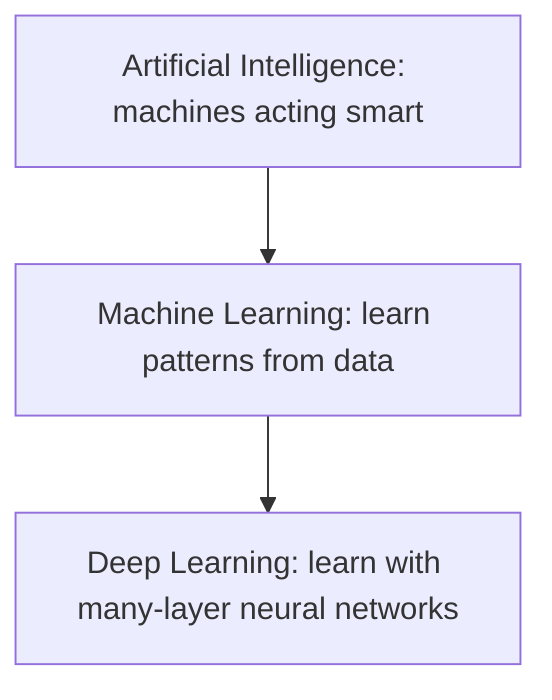
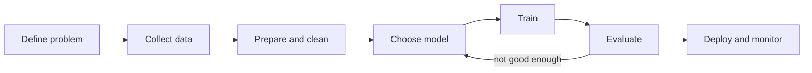

# Session 01: AI and Machine Learning Basics

> Module: AI Primer · Diploma in AI · Term 2 · ⏱ ~2 hours

Your phone unlocks with your face, Google Maps finds a route around traffic on Shahrah-e-Faisal, and Daraz shows products you may like. All of these are **Artificial Intelligence (AI)** at work. In this first session you will learn what AI really means, the different kinds of AI systems, and the step-by-step workflow used to build a **Machine Learning (ML)** model.

## 🎯 Learning Objectives

- Define Artificial Intelligence and give real applications from daily life
- Classify AI systems by capability (narrow, general, super) and by functionality
- Explain how Machine Learning differs from traditional programming
- Describe the three main types of ML: supervised, unsupervised and reinforcement
- Walk through the ML workflow from data collection to deployment
- Decide when ML is (and is not) the right tool for a problem

## 📖 Concepts Explained

### 1. What is Artificial Intelligence?

**Artificial Intelligence** is the field of computer science that builds systems able to do tasks that normally need human intelligence: understanding language, recognising images, making decisions, planning and learning from experience.

> **Analogy:** A calculator follows fixed steps. An AI system is more like a trainee: it looks at examples, notices patterns and improves with practice.

| Everyday application | What the AI does |
|---|---|
| Face unlock | Recognises your face from camera pixels |
| Voice assistants | Converts speech to text and understands the request |
| Navigation apps | Predicts traffic and picks the fastest route |
| Spam filters | Decides whether an email is spam |
| Online shopping | Recommends products based on your history |
| Banking | Flags unusual card transactions as possible fraud |

### 2. Types of AI systems

**By capability (how smart):**

| Type | Meaning | Exists today? |
|---|---|---|
| Narrow AI (Weak AI) | Very good at one task only (chess, translation) | Yes, all current AI |
| General AI (Strong AI) | Human-level ability across any task | No, research goal |
| Super AI | Smarter than humans in every area | No, theoretical |

**By functionality (how it works):**

| Type | Idea | Example |
|---|---|---|
| Reactive machines | React to the current input, no memory | A chess engine judging the current board |
| Limited memory | Use recent past data to decide | Self-driving car tracking nearby cars |
| Theory of mind | Understand emotions and intentions | Research stage |
| Self-aware | Have their own consciousness | Science fiction |

### 3. AI, ML and Deep Learning



AI is the big umbrella. **Machine Learning** is the part of AI where systems learn from data instead of being told every rule. **Deep Learning** (Session 02) is a part of ML that uses large neural networks.

### 4. Traditional programming vs Machine Learning

| | Traditional programming | Machine Learning |
|---|---|---|
| Input | Data + rules written by a human | Data + correct answers (examples) |
| Output | Answers | A model (the learned rules) |
| Works best when | Rules are clear and fixed (tax formula) | Rules are hard to write (recognising a cat) |

### 5. Types of Machine Learning

| Type | Data | Goal | Example |
|---|---|---|---|
| **Supervised** | Inputs with labels | Predict a label or number | House price, spam or not |
| **Unsupervised** | Inputs only | Find groups or structure | Customer segments |
| **Reinforcement** | Rewards from actions | Learn the best actions | Game-playing agent, robot walking |

Supervised learning has two flavours: **classification** (predict a category: pass/fail) and **regression** (predict a number: price).

### 6. The Machine Learning workflow



1. **Define the problem**: what exactly to predict and how success is measured.
2. **Collect data**: databases, files, sensors, APIs.
3. **Prepare data**: remove errors, fill missing values, convert text to numbers, split into train/test sets.
4. **Choose a model**: decision tree, k-nearest neighbours, linear regression, etc.
5. **Train**: the model learns patterns from the training data.
6. **Evaluate**: test on unseen data using metrics such as accuracy.
7. **Deploy and monitor**: put the model inside an app and watch its performance over time.

> **Why split the data?** If a student sees the exam paper while studying, a high score proves nothing. The test set is the "unseen exam" for the model.

### 7. When should you use Machine Learning?

Use ML when: the rules are too complex to write by hand, there is plenty of good data, and patterns change over time (fraud, prices). Avoid ML when: a simple formula works, there is very little data, or every decision must be fully explainable by law and a rule system can do it.

## 💻 Code Examples

### Example 1: Rules vs learning

📄 File: [`rules_vs_learning.py`](./rules_vs_learning.py)

```python
# rules_vs_learning.py
# Traditional programming (we write the rules) vs Machine Learning (the computer learns the rules).
# Command:  python rules_vs_learning.py

from sklearn.tree import DecisionTreeClassifier

# --- Part 1: Traditional programming -------------------------------------
# A human writes the rule by hand.
def is_hot_by_rule(temperature):
    if temperature >= 35:      # rule chosen by a human
        return "hot"
    return "not hot"

print("Rule-based answers:")
for t in [20, 34, 36, 41]:
    print(f"  {t} C ->", is_hot_by_rule(t))

# --- Part 2: Machine Learning --------------------------------------------
# We only give EXAMPLES (data + correct answers). The model finds the rule itself.
temperatures = [[18], [22], [25], [29], [31], [33], [36], [38], [40], [44]]  # inputs (features)
labels = ["not hot", "not hot", "not hot", "not hot", "not hot",
          "not hot", "hot", "hot", "hot", "hot"]                        # correct answers

model = DecisionTreeClassifier()     # step 1: choose a model
model.fit(temperatures, labels)      # step 2: learn from examples

print("\nML answers (model learned the rule from data):")
for t in [20, 34, 36, 41]:
    prediction = model.predict([[t]])[0]   # step 3: predict for new inputs
    print(f"  {t} C ->", prediction)

# The tree found its own threshold. Let us print it.
threshold = model.tree_.threshold[0]
print(f"\nThreshold learned by the model: {threshold:.1f} C")
```

**How it works:** Part 1 uses a rule a human typed (`>= 35`). Part 2 gives the model only examples; `fit()` learns a threshold from them and `predict()` applies it to new temperatures. The printed threshold shows the rule the model discovered by itself.

### Example 2: The ML workflow step by step

📄 File: [`ml_workflow.py`](./ml_workflow.py)

```python
# ml_workflow.py
# The complete Machine Learning workflow in small, clear steps.
# Dataset: the famous Iris flowers dataset that ships with scikit-learn.
# Command:  python ml_workflow.py

from sklearn.datasets import load_iris
from sklearn.model_selection import train_test_split
from sklearn.neighbors import KNeighborsClassifier
from sklearn.metrics import accuracy_score

# Step 1: Collect data
iris = load_iris()
X = iris.data        # features: sepal length, sepal width, petal length, petal width
y = iris.target      # label: 0 = setosa, 1 = versicolor, 2 = virginica
print("Step 1  rows:", X.shape[0], "| features:", X.shape[1])

# Step 2: Prepare data -> split into training part and testing part
X_train, X_test, y_train, y_test = train_test_split(
    X, y, test_size=0.2, random_state=42)   # 80% train, 20% test
print("Step 2  train rows:", len(X_train), "| test rows:", len(X_test))

# Step 3: Choose a model
model = KNeighborsClassifier(n_neighbors=3)  # looks at the 3 most similar flowers
print("Step 3  model:", model)

# Step 4: Train the model
model.fit(X_train, y_train)
print("Step 4  training finished")

# Step 5: Evaluate on data the model has never seen
predictions = model.predict(X_test)
accuracy = accuracy_score(y_test, predictions)
print(f"Step 5  accuracy on test data: {accuracy:.2%}")

# Step 6: Use the model on a brand new flower
new_flower = [[5.0, 3.4, 1.5, 0.2]]
predicted_class = model.predict(new_flower)[0]
print("Step 6  new flower is:", iris.target_names[predicted_class])
```

**How it works:** each printed "Step" matches the workflow diagram. `train_test_split` keeps 20% of the flowers hidden for testing, `fit` trains, and `accuracy_score` compares predictions with the true answers.

### Example 3: Supervised, unsupervised and reinforcement in one file

📄 File: [`ml_types_demo.py`](./ml_types_demo.py)

```python
# ml_types_demo.py
# One tiny example of each main type of Machine Learning.
# Command:  python ml_types_demo.py

import numpy as np
from sklearn.linear_model import LinearRegression
from sklearn.cluster import KMeans

# 1) Supervised learning (we have the answers) -> predict house price from size
sizes = np.array([[500], [800], [1000], [1200], [1500]])   # square feet
prices = np.array([50, 78, 100, 118, 152])                  # lakh rupees
reg = LinearRegression().fit(sizes, prices)
print("Supervised: price of 1100 sq ft =", round(reg.predict([[1100]])[0], 1), "lakh")

# 2) Unsupervised learning (no answers) -> group customers by spending
spending = np.array([[2], [3], [2.5], [20], [22], [21]])    # thousand rupees per month
groups = KMeans(n_clusters=2, n_init=10, random_state=0).fit_predict(spending)
print("Unsupervised: customer groups =", groups)

# 3) Reinforcement learning (learn by reward) -> pick the best of 3 slot machines
rng = np.random.default_rng(0)
true_win_rates = [0.2, 0.5, 0.8]      # hidden from the agent
estimates = [0.0, 0.0, 0.0]           # what the agent believes
counts = [0, 0, 0]
for step in range(500):
    if rng.random() < 0.1:                     # 10% of the time: explore randomly
        arm = int(rng.integers(3))
    else:                                      # 90% of the time: use the best guess
        arm = int(np.argmax(estimates))
    reward = 1 if rng.random() < true_win_rates[arm] else 0
    counts[arm] += 1
    estimates[arm] += (reward - estimates[arm]) / counts[arm]   # running average
print("Reinforcement: agent's estimates =", [round(e, 2) for e in estimates])
print("Reinforcement: best machine found =", int(np.argmax(estimates)))
```

**How it works:** linear regression uses prices (labels) so it is supervised. K-Means gets no labels and still splits customers into low and high spenders. The slot-machine agent is never told the best machine; it learns from rewards by trying (explore) and repeating what works (exploit).

## 🧪 Lab Practice

1. Run all three files and write down the output of each step.
2. In `rules_vs_learning.py`, change the labels so that 33 C is also "hot". Re-run and see how the learned threshold changes.
3. In `ml_workflow.py`, try `n_neighbors=1`, `5` and `15`. Note the accuracy for each.
4. In `ml_types_demo.py`, change the exploration rate from `0.1` to `0.5`. Does the agent still find the best machine?
5. List five apps on your phone and write which type of ML (supervised, unsupervised or reinforcement) each one most likely uses.

## 📝 Assignment

Write `pass_fail_model.py`: create a small dataset of 12 students with `[study_hours, attendance_percent]` and a label `pass`/`fail`. Train a `DecisionTreeClassifier`, test it on 3 new students, and print the predictions. Comment every step with the matching ML workflow step.

## ❓ Quick Quiz

1. All AI in use today belongs to which capability type?
2. Grouping customers without any labels is which type of ML?
3. Why do we keep a separate test set?
4. Predicting tomorrow's temperature is classification or regression?
5. Name the step that comes after training in the ML workflow.

<details><summary>Answers</summary>

1. Narrow (weak) AI
2. Unsupervised learning
3. To measure performance on data the model has never seen
4. Regression (the output is a number)
5. Evaluation

</details>

## 💼 Interview Questions

1. **What is the difference between AI and Machine Learning?** AI is the broad goal of making machines act intelligently; ML is one way to achieve it, where the machine learns patterns from data instead of following hand-written rules.
2. **Explain supervised vs unsupervised learning with examples.** Supervised learning uses labelled data, such as emails marked spam/not spam. Unsupervised learning finds structure in unlabelled data, such as grouping shoppers by behaviour.
3. **Describe the ML project lifecycle.** Define the problem, collect and prepare data, choose and train a model, evaluate it on unseen data, then deploy and monitor it.

## ✅ Summary

- AI makes machines perform tasks that need human-like intelligence; all current AI is narrow AI.
- ML learns rules from examples; deep learning is ML with large neural networks.
- The three ML types are supervised, unsupervised and reinforcement learning.
- The ML workflow: define, collect, prepare, choose, train, evaluate, deploy.
- Use ML when rules are hard to write and good data is available.

---

[🏠 Module Home](../README.md) · [Next ➡](../Session-02-Deep-Learning-and-Neural-Networks/README.md)

Prepared by Zeeshan Abbas · Aptech Learning North Nazimabad
