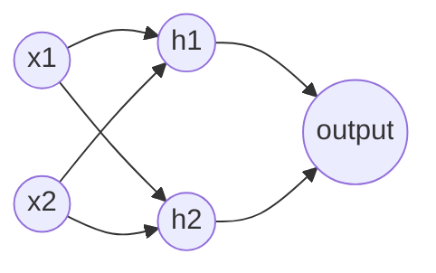

# Session 02: Deep Learning and Neural Networks

> Module: AI Primer · Diploma in AI · Term 2 · ⏱ ~2 hours

When you upload a photo and Facebook suggests who is in it, or when Google Translate turns Urdu into English, a **deep learning** model is doing the work. This session explains what deep learning is, how it differs from classic machine learning, how a neural network is built from simple neurons, and walks through a stock-price prediction case study.

## 🎯 Learning Objectives

- Define deep learning in one clear sentence
- Compare deep learning with traditional machine learning
- Explain how an artificial neuron and a neural network work
- Name the popular deep learning architectures and what each is used for
- Describe real uses of deep learning across industries
- Build and evaluate a small neural network in Python

## 📖 Concepts Explained

### 1. What is deep learning?

**Deep learning** is a type of machine learning that uses **artificial neural networks with many layers** to learn useful features directly from raw data such as pixels, sound waves or text.

"Deep" simply means many layers. Each layer learns a slightly more complex idea than the one before. In a face recogniser: layer 1 finds edges, layer 2 finds eyes and noses, layer 3 finds whole faces.

### 2. Deep learning vs machine learning

| Point | Classic ML | Deep learning |
|---|---|---|
| Features | Humans design them (e.g. "word count") | The network learns them itself |
| Data needed | Works with small data (hundreds of rows) | Needs large data (thousands to millions) |
| Hardware | A normal laptop CPU | Often needs a GPU |
| Training time | Seconds to minutes | Minutes to days |
| Explainability | Easier (decision trees) | Harder ("black box") |
| Best for | Tables (Excel-style data) | Images, audio, text, video |

> **Rule of thumb:** tabular data with a few thousand rows → start with classic ML. Images, speech or language → deep learning.

### 3. The artificial neuron

A neuron takes inputs, multiplies each by a **weight** (importance), adds a **bias**, and passes the result through an **activation function**.

```
output = activation( w1*x1 + w2*x2 + ... + b )
```

| Activation | Output range | Typical use |
|---|---|---|
| Step | 0 or 1 | The original perceptron |
| Sigmoid | 0 to 1 | Probability output (yes/no) |
| ReLU | 0 to infinity | Hidden layers (most popular) |
| Softmax | probabilities that add to 1 | Output layer for many classes |

### 4. A neural network (ANN)



- **Input layer**: receives the data (one neuron per feature).
- **Hidden layers**: do the learning. More layers = deeper network.
- **Output layer**: gives the prediction.

**How it learns:** (1) *forward pass*: data flows through and a prediction comes out; (2) a *loss function* measures the error; (3) *backpropagation* works out how much each weight caused the error; (4) *gradient descent* nudges all weights to reduce the error. Repeat many times (epochs).

### 5. Popular deep learning architectures

| Architecture | Short form | Best for | Example |
|---|---|---|---|
| Multilayer Perceptron | MLP | Tables, simple tasks | Credit scoring |
| Convolutional Neural Network | CNN | Images, video | Medical X-ray reading |
| Recurrent Neural Network / LSTM | RNN / LSTM | Sequences, time series | Stock or weather forecasting |
| Transformer | - | Language, now also images | ChatGPT, translation |
| Autoencoder | - | Compression, anomaly detection | Detecting faulty machines |
| Generative Adversarial Network | GAN | Creating realistic images | Image generation |

### 6. Deep learning across sectors

| Sector | Application |
|---|---|
| Healthcare | Detecting tumours in scans, predicting disease risk |
| Finance | Fraud detection, algorithmic trading, credit scoring |
| Retail | Product recommendations, demand forecasting |
| Transport | Self-driving cars, number-plate recognition |
| Agriculture | Detecting crop disease from leaf photos |
| Media | Speech-to-text, auto subtitles, content moderation |

### 7. Case study: predicting stock prices

The idea: use the last few days' prices as inputs and tomorrow's price as the output.

1. **Collect** daily closing prices.
2. **Create features** with a sliding window. Using daily *changes* (today minus yesterday) instead of raw prices keeps values in a stable range, so the model is not confused when prices climb above anything it saw in training.
3. **Split by time**: train on older data, test on recent data. Never shuffle time series, or the model "sees the future".
4. **Convert back**: predicted price = yesterday's price + predicted change.
5. **Train** a neural network (MLP here; LSTMs are common in practice).
6. **Compare with a baseline** such as "tomorrow = today". A model that cannot beat this is not useful.

> ⚠️ Real markets react to news and human behaviour. Treat any stock model as a learning exercise, never as financial advice.

## 💻 Code Examples

### Example 1: A perceptron from scratch

📄 File: [`perceptron.py`](./perceptron.py)

```python
# perceptron.py
# One artificial neuron (a perceptron) built from scratch with NumPy.
# It learns the logical AND gate: output 1 only when both inputs are 1.
# Command:  python perceptron.py

import numpy as np

# Training data: 4 examples of the AND gate
X = np.array([[0, 0], [0, 1], [1, 0], [1, 1]])
y = np.array([0, 0, 0, 1])

weights = np.zeros(2)     # one weight per input, start at zero
bias = 0.0
learning_rate = 0.1

def step(value):
    """Activation function: fire (1) if value is positive, else 0."""
    return 1 if value > 0 else 0

# Training loop: show all examples several times (each pass = one epoch)
for epoch in range(10):
    errors = 0
    for inputs, target in zip(X, y):
        weighted_sum = np.dot(inputs, weights) + bias   # w1*x1 + w2*x2 + b
        output = step(weighted_sum)
        error = target - output                         # 0 if correct
        weights += learning_rate * error * inputs       # nudge weights
        bias += learning_rate * error                   # nudge bias
        errors += abs(error)
    print(f"Epoch {epoch + 1}: mistakes = {errors}")
    if errors == 0:
        break

print("\nLearned weights:", weights, "bias:", round(bias, 2))
for inputs in X:
    print(inputs, "->", step(np.dot(inputs, weights) + bias))
```

**How it works:** for every example the neuron computes a weighted sum, applies the step function and compares with the target. If wrong, the weights move a little towards the right answer. After a few epochs it makes zero mistakes on the AND gate.

### Example 2: A multi-layer network for handwritten digits

📄 File: [`neural_network_digits.py`](./neural_network_digits.py)

```python
# neural_network_digits.py
# A small multi-layer neural network that reads handwritten digits (8x8 pixel images).
# Command:  python neural_network_digits.py

from sklearn.datasets import load_digits
from sklearn.model_selection import train_test_split
from sklearn.preprocessing import StandardScaler
from sklearn.neural_network import MLPClassifier
from sklearn.metrics import accuracy_score

# 1) Load 1,797 images of digits 0-9. Each image = 64 pixel values.
digits = load_digits()
X, y = digits.data, digits.target
print("Images:", X.shape[0], "| pixels per image:", X.shape[1])

# 2) Split into training and testing sets
X_train, X_test, y_train, y_test = train_test_split(X, y, test_size=0.25, random_state=1)

# 3) Scale pixels so every input has a similar range (helps the network learn)
scaler = StandardScaler()
X_train = scaler.fit_transform(X_train)
X_test = scaler.transform(X_test)

# 4) Build the network: 64 inputs -> 32 neurons -> 16 neurons -> 10 outputs
network = MLPClassifier(hidden_layer_sizes=(32, 16), activation="relu",
                        max_iter=500, random_state=1)
network.fit(X_train, y_train)

# 5) Evaluate
predictions = network.predict(X_test)
print(f"Test accuracy: {accuracy_score(y_test, predictions):.2%}")
print("Layers (weight matrices):", [w.shape for w in network.coefs_])

# 6) Look at the first 10 test images
print("True     :", y_test[:10].tolist())
print("Predicted:", predictions[:10].tolist())
```

**How it works:** `MLPClassifier` builds a network with two hidden layers of 32 and 16 ReLU neurons. Scaling the pixels makes training faster and more stable. `coefs_` shows the weight matrices between layers: 64→32, 32→16, 16→10.

### Example 3: Stock price case study

📄 File: [`stock_price_case_study.py`](./stock_price_case_study.py)

```python
# stock_price_case_study.py
# Case study: predict the next day's closing price from the previous 5 days.
# We generate a made-up price series so the file runs offline.
# NOTE: real stock markets are very hard to predict. This is a learning exercise only.
# Command:  python stock_price_case_study.py

import numpy as np
import pandas as pd
from sklearn.neural_network import MLPRegressor
from sklearn.metrics import mean_absolute_error

# 1) Create 300 days of fake prices: slow upward trend + wave + small noise
rng = np.random.default_rng(7)
days = np.arange(300)
prices = 100 + 0.2 * days + 5 * np.sin(days / 10) + rng.normal(0, 0.3, 300)
data = pd.DataFrame({"close": prices})

# 2) Work with daily CHANGES (today - yesterday). Changes stay in a similar range
#    even when the price itself keeps rising, which makes learning much easier.
data["change"] = data["close"].diff()

# 3) Build features: the last 5 daily changes ("lags")
window = 5
for lag in range(1, window + 1):
    data[f"change_lag_{lag}"] = data["change"].shift(lag)
data = data.dropna()                       # first rows have no full history

feature_columns = [f"change_lag_{i}" for i in range(1, window + 1)]
X = data[feature_columns].values
y = data["change"].values                  # target: tomorrow's change

# 4) Time-series split: train on the past, test on the most recent 60 days (no shuffling!)
X_train, X_test = X[:-60], X[-60:]
y_train, y_test = y[:-60], y[-60:]

# 5) Train a small neural network
model = MLPRegressor(hidden_layer_sizes=(16, 8), max_iter=3000, random_state=7)
model.fit(X_train, y_train)

# 6) Turn predicted changes back into prices: price = yesterday's price + change
yesterday = data["close"].shift(1).values[-60:]
real_prices = data["close"].values[-60:]
predicted_prices = yesterday + model.predict(X_test)
print(f"Network error on last 60 days : {mean_absolute_error(real_prices, predicted_prices):.2f} rupees")

# 7) Compare with the simplest baseline: "tomorrow = today"
print(f"Baseline error (tomorrow=today): {mean_absolute_error(real_prices, yesterday):.2f} rupees")

for real, guess in list(zip(real_prices, predicted_prices))[:5]:
    print(f"  real {real:7.2f}  predicted {guess:7.2f}")
```

**How it works:** `diff()` turns prices into daily changes and `shift()` creates the lag columns. The last 60 days are kept for testing without shuffling. The network predicts tomorrow's change, which is added to yesterday's price. Finally the model's error is compared with the naive baseline so we can judge whether the network actually learned something.

## 🧪 Lab Practice

1. Run `perceptron.py`. Change `y` to the OR gate `[0, 1, 1, 1]` and confirm it learns.
2. Change `y` to XOR `[0, 1, 1, 0]`. Notice it never reaches zero mistakes: one neuron cannot solve XOR, which is why we need hidden layers.
3. In `neural_network_digits.py`, try `hidden_layer_sizes=(8,)` and `(64, 32)`. Record the accuracy.
4. In `stock_price_case_study.py`, change `window` to 3 and 10. Does the network still beat the baseline?
5. Draw (on paper) a network with 3 inputs, one hidden layer of 4 neurons and 1 output. Count the weights.

## 📝 Assignment

Write `xor_network.py` that solves the XOR gate using `MLPClassifier(hidden_layer_sizes=(4,), activation="tanh", max_iter=5000, random_state=0)`. Print predictions for all four inputs and explain in a comment why the hidden layer makes XOR possible.

## ❓ Quick Quiz

1. What does "deep" mean in deep learning?
2. Which activation function is most popular for hidden layers?
3. Which architecture is best suited to images?
4. Why must time-series data not be shuffled before splitting?
5. What algorithm calculates how much each weight contributed to the error?

<details><summary>Answers</summary>

1. The network has many hidden layers
2. ReLU
3. CNN (Convolutional Neural Network)
4. Shuffling lets the model train on future values, giving a falsely good score
5. Backpropagation

</details>

## 💼 Interview Questions

1. **When would you choose deep learning over classic ML?** When the data is unstructured (images, audio, text), the dataset is large, and enough compute is available. For small tabular data classic ML is usually faster and just as accurate.
2. **What is an activation function and why is it needed?** It adds non-linearity. Without it, many layers collapse into a single linear equation and cannot learn complex patterns like XOR.
3. **What is overfitting in a neural network and how do you reduce it?** The network memorises training data and fails on new data. Reduce it with more data, early stopping, dropout, regularisation or a smaller network.

## ✅ Summary

- Deep learning uses many-layer neural networks that learn features from raw data.
- A neuron = weighted sum + bias + activation; networks stack neurons in layers.
- Networks learn by forward pass, loss, backpropagation and gradient descent.
- CNNs suit images, RNN/LSTMs suit sequences, Transformers suit language.
- Always compare a forecasting model with a simple baseline.

---

[⬅ Previous](../Session-01-AI-and-Machine-Learning-Basics/README.md) · [🏠 Module Home](../README.md) · [Next ➡](../Session-03-Problem-Solving-and-Agents-in-AI/README.md)

Prepared by Zeeshan Abbas · Aptech Learning North Nazimabad
