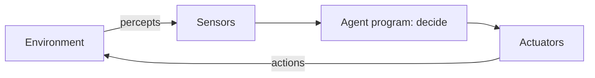

# Session 03: Problem Solving and Agents in AI

> Module: AI Primer · Diploma in AI · Term 2 · ⏱ ~2 hours

Before a GPS can give you directions, someone has to describe the problem precisely: where you are, where you want to go, which roads exist and what each costs. Much of AI is exactly this: **turning a real situation into a problem a computer can solve**, and building an **agent** that senses, decides and acts. This session introduces both ideas.

## 🎯 Learning Objectives

- Explain why problem solving is at the heart of AI
- Formulate a problem using states, actions, goal test and path cost
- Describe and compare the main types of intelligent agents
- Use the PEAS framework to describe an agent's task environment
- Break a complex problem into smaller sub-problems
- Code simple reflex and goal-based agents in Python

## 📖 Concepts Explained

### 1. Why problem solving matters in AI

An intelligent system is useful only if it can reach a goal: deliver a parcel, win a game, schedule classes or diagnose a fault. **Problem solving** is the process of finding a sequence of actions that moves from the current situation to a goal situation. Most AI techniques (search, planning, learning) are tools for this one job.

### 2. Formulating a problem

| Part | Meaning | Example: drive from Gulshan to Saddar |
|---|---|---|
| **Initial state** | Where we start | At Gulshan |
| **Actions** | What we can do in each state | Drive along a connected road |
| **Transition model** | Result of an action | Arrive at the next area |
| **Goal test** | How we know we are done | Are we at Saddar? |
| **Path cost** | Price of a solution | Total kilometres or minutes |

The set of all reachable states is the **state space**. A **solution** is a path from the initial state to a goal; the **optimal solution** has the lowest path cost.

### 3. Problem-solving techniques

| Technique | Idea | Example |
|---|---|---|
| Search | Explore the state space systematically | Route finding (Session 04) |
| Heuristics | Use a smart rule of thumb to guide choices | "Go towards the destination" |
| Divide and conquer | Split into smaller sub-problems | Tower of Hanoi, merge sort |
| Constraint satisfaction | Find values that satisfy all rules | Timetable with no clashes |
| Planning | Order actions to reach a goal | Robot assembling parts |
| Learning | Improve from experience | ML models (Sessions 01-02) |

### 4. What is an agent?

An **agent** is anything that **perceives** its environment through **sensors** and **acts** on it through **actuators**.



| Agent | Sensors | Actuators |
|---|---|---|
| Robot vacuum | Dirt sensor, bump sensor | Wheels, suction motor |
| Chatbot | Text input | Text reply |
| Self-driving car | Cameras, radar, GPS | Steering, brakes, accelerator |

### 5. Types of agents

| Agent type | How it decides | Weakness |
|---|---|---|
| **Simple reflex** | Fixed if-then rules on the current percept | No memory; can loop forever |
| **Model-based reflex** | Keeps an internal model of the world | Model may be wrong |
| **Goal-based** | Picks actions that lead to a goal | Needs search/planning, slower |
| **Utility-based** | Picks the action with the highest "happiness" score | Utility is hard to define |
| **Learning** | Improves its own behaviour from feedback | Needs data and time |

> **Analogy:** a reflex agent is a light that turns on when it detects motion. A goal-based agent is a taxi driver who knows the destination. A utility-based agent is the driver who also chooses the cheapest, safest and fastest route.

### 6. PEAS: describing the task environment

| Letter | Stands for | Automated taxi example |
|---|---|---|
| P | Performance measure | Safety, speed, fare, comfort |
| E | Environment | Roads, traffic, pedestrians, weather |
| A | Actuators | Steering, brake, horn, display |
| S | Sensors | Cameras, GPS, speedometer |

Environments can be **fully or partially observable**, **deterministic or stochastic** (random), **static or dynamic**, and **single or multi-agent**. A chess game is fully observable and deterministic; driving is partially observable, stochastic and dynamic.

### 7. Breaking down complex problems

Large problems become manageable when split into smaller ones:

1. **Understand** the goal and constraints.
2. **Decompose** into independent sub-goals.
3. **Solve** each sub-goal (maybe with the same method again: recursion).
4. **Combine** the partial solutions.
5. **Check** the result against the goal.

Example: "organise a college tech fair" → venue, budget, speakers, marketing, registration. Each part is solved by a smaller team, then combined.

## 💻 Code Examples

### Example 1: Simple reflex agent

📄 File: [`vacuum_reflex_agent.py`](./vacuum_reflex_agent.py)

```python
# vacuum_reflex_agent.py
# A SIMPLE REFLEX AGENT: it looks only at what it senses right now and follows
# condition -> action rules. World: two rooms, A and B, each Clean or Dirty.
# Command:  python vacuum_reflex_agent.py

# The environment (the world the agent lives in)
world = {"A": "Dirty", "B": "Dirty"}
agent_location = "A"

def reflex_vacuum_agent(location, status):
    """Percept = (location, status). Returns an action using fixed rules."""
    if status == "Dirty":
        return "Suck"
    elif location == "A":
        return "MoveRight"
    else:
        return "MoveLeft"

# Run the agent for 6 time steps
score = 0
for step in range(1, 7):
    percept = (agent_location, world[agent_location])   # 1) SENSE
    action = reflex_vacuum_agent(*percept)              # 2) THINK (rule lookup)

    # 3) ACT: the action changes the environment
    if action == "Suck":
        world[agent_location] = "Clean"
        score += 10                                     # reward for cleaning
    elif action == "MoveRight":
        agent_location = "B"
        score -= 1                                      # small cost for moving
    elif action == "MoveLeft":
        agent_location = "A"
        score -= 1

    print(f"Step {step}: percept={percept} action={action:<9} world={world}")

print("Performance score:", score)
# Notice: after both rooms are clean the agent keeps moving back and forth,
# wasting points. It has no memory, so it does not know the job is finished.
```

**How it works:** each loop is one sense-think-act cycle. The agent function only sees the current room, so after both rooms are clean it keeps moving and loses points. This shows why memory matters.

### Example 2: Model-based, goal-based agent

📄 File: [`goal_based_agent.py`](./goal_based_agent.py)

```python
# goal_based_agent.py
# A MODEL-BASED + GOAL-BASED agent: it remembers what it has seen (internal model)
# and stops when its goal "all rooms clean" is reached.
# Command:  python goal_based_agent.py

world = {"A": "Dirty", "B": "Clean", "C": "Dirty"}   # three rooms in a row
rooms_in_order = ["A", "B", "C"]
location = "A"

memory = {"A": "Unknown", "B": "Unknown", "C": "Unknown"}   # the agent's internal model

def goal_reached(model):
    """Goal test: every room is known to be clean."""
    return all(status == "Clean" for status in model.values())

steps = 0
while not goal_reached(memory):
    steps += 1
    status = world[location]          # sense the current room
    memory[location] = status         # update the internal model

    if status == "Dirty":
        world[location] = "Clean"
        memory[location] = "Clean"
        print(f"Step {steps}: cleaned room {location}")
        continue

    # Choose the next room that is not yet known to be clean
    targets = [room for room in rooms_in_order if memory[room] != "Clean"]
    if not targets:
        break
    next_room = targets[0]
    print(f"Step {steps}: room {location} is clean, moving to {next_room}")
    location = next_room

print("Goal reached in", steps, "steps. Memory:", memory)
```

**How it works:** the `memory` dictionary is the agent's model of the world. `goal_reached()` is the goal test. The agent stops as soon as it knows every room is clean, so it never wastes moves.

### Example 3: Divide and conquer

📄 File: [`tower_of_hanoi.py`](./tower_of_hanoi.py)

```python
# tower_of_hanoi.py
# PROBLEM DECOMPOSITION: solve a big problem by breaking it into smaller copies of itself.
# Move all disks from peg A to peg C. Rules: one disk at a time, never a big disk on a small one.
# Command:  python tower_of_hanoi.py

moves = []   # we store every move so we can count them

def solve_hanoi(disks, source, helper, target):
    """Move `disks` disks from source to target using helper."""
    if disks == 1:                                   # smallest sub-problem: just move it
        moves.append((source, target))
        return
    solve_hanoi(disks - 1, source, target, helper)   # 1) move the top n-1 out of the way
    moves.append((source, target))                   # 2) move the biggest disk
    solve_hanoi(disks - 1, helper, source, target)   # 3) put the n-1 disks back on top

number_of_disks = 3
solve_hanoi(number_of_disks, "A", "B", "C")

for i, (from_peg, to_peg) in enumerate(moves, start=1):
    print(f"Move {i}: {from_peg} -> {to_peg}")

print("Total moves:", len(moves), "| formula 2^n - 1 =", 2 ** number_of_disks - 1)
```

**How it works:** moving 3 disks is split into "move 2 disks", "move the big one", "move 2 disks again". Each "move 2 disks" splits again until only one disk is left, which is trivial.

## 🧪 Lab Practice

1. Run `vacuum_reflex_agent.py` and count how many points are wasted after the rooms are clean.
2. Add a third room "C" to the reflex agent. What rules do you need now?
3. Change the starting world in `goal_based_agent.py` to all rooms dirty and check the step count.
4. Run `tower_of_hanoi.py` with 4 and 5 disks. Confirm the moves follow `2^n - 1`.
5. Write the PEAS description for (a) a Foodpanda delivery-assignment system and (b) an exam proctoring camera.

## 📝 Assignment

Write `traffic_light_agent.py`: a reflex agent that receives a percept `(cars_waiting, pedestrian_button)` and returns `"green"`, `"yellow"` or `"red"` using at least three rules. Then add memory (model-based) so the light never stays green for more than 3 steps in a row. Print 10 simulated steps.

## ❓ Quick Quiz

1. Name the five parts of a problem formulation.
2. Which agent type has no memory at all?
3. What does the "U" in a utility-based agent help it compare?
4. What does PEAS stand for?
5. Is a card game where you cannot see opponents' cards fully or partially observable?

<details><summary>Answers</summary>

1. Initial state, actions, transition model, goal test, path cost
2. Simple reflex agent
3. How good (desirable) each possible outcome is
4. Performance measure, Environment, Actuators, Sensors
5. Partially observable

</details>

## 💼 Interview Questions

1. **What is the difference between a goal-based and a utility-based agent?** A goal-based agent only checks whether a goal is reached; a utility-based agent compares different ways of reaching it and prefers the one with the best score (cheaper, faster, safer).
2. **What is a state space?** The set of all states reachable from the initial state through actions. Search algorithms explore this space to find a path to the goal.
3. **Give an example of a stochastic, partially observable environment.** Driving in city traffic: other drivers behave unpredictably and the agent cannot see everything around it.

## ✅ Summary

- Problem solving = finding actions that move from the initial state to a goal.
- A problem is defined by initial state, actions, transitions, goal test and path cost.
- Agents sense and act; types range from simple reflex to learning agents.
- PEAS and environment properties describe what an agent must handle.
- Divide and conquer turns big problems into small, solvable ones.

---

[⬅ Previous](../Session-02-Deep-Learning-and-Neural-Networks/README.md) · [🏠 Module Home](../README.md) · [Next ➡](../Session-04-Search-Algorithms-in-AI/README.md)

Prepared by Zeeshan Abbas · Aptech Learning North Nazimabad
