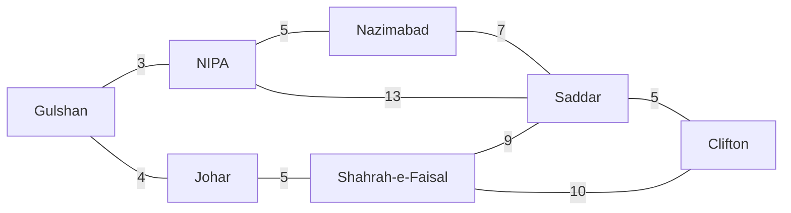

# Session 04: Search Algorithms in AI

> Module: AI Primer · Diploma in AI · Term 2 · ⏱ ~2 hours

Finding a route on Google Maps, solving a Rubik's cube, or planning moves in chess all have something in common: the computer **searches** through many possible situations until it finds one that meets the goal. Search is so general that it is often called a *universal problem-solving method*. In this session you will understand a problem completely, break it into a search problem, and code the classic uninformed and informed search algorithms.

## 🎯 Learning Objectives

- Fully understand a problem before trying to solve it
- Represent a problem as a graph or tree of states
- Explain where search is used in modern AI applications
- Distinguish uninformed (blind) search from informed (heuristic) search
- Implement BFS, DFS, Uniform Cost Search, Greedy Best-First and A* in Python
- Compare algorithms on completeness, optimality, time and memory

## 📖 Concepts Explained

### 1. Understand the problem completely

Before writing any search code, answer these questions:

| Question | Route-finding answer |
|---|---|
| What is a state? | The area you are currently in |
| What is the start state? | Gulshan |
| What is the goal? | Reach Clifton |
| Which actions are allowed? | Drive to a directly connected area |
| What does an action cost? | Road distance in km |
| Do we want *any* solution or the *best* one? | The shortest route |

A problem that is not understood clearly leads to a search that is either wrong or far too slow.

### 2. Break the problem into a search graph

States become **nodes**; actions become **edges**; costs become **edge weights**. Search builds a **search tree** from the start node, and keeps a **frontier** (paths waiting to be explored) and a **visited set** (to avoid going round in circles).



*(Distances are invented for practice.)*

### 3. Where search is used today

| Application | What is being searched |
|---|---|
| Maps and ride-hailing | Road networks for the fastest route |
| Games (chess, Ludo bots) | Future moves and counter-moves |
| Robotics | Paths that avoid obstacles |
| Puzzles and scheduling | Arrangements that satisfy all rules |
| Web search engines | Huge indexes of pages for best matches |
| Network routing | Paths for data packets across the internet |

### 4. Uninformed (blind) search

These algorithms know nothing about where the goal is; they only know how to expand nodes.

| Algorithm | Frontier type | Picks next | Finds shortest? |
|---|---|---|---|
| **BFS** | Queue (FIFO) | Oldest path | Yes, if all steps cost the same (fewest stops) |
| **DFS** | Stack (LIFO) | Newest path | No |
| **Uniform Cost (UCS)** | Priority queue | Lowest total cost g(n) | Yes, with any positive costs |

> **Analogy:** BFS is like dropping a stone in water: the ripple spreads evenly in all directions. DFS is like exploring a maze by always taking the first corridor until you hit a dead end, then backing up.

### 5. Informed (heuristic) search

A **heuristic** h(n) is an *estimate* of the cost from node n to the goal, such as straight-line distance.

| Algorithm | Score used | Behaviour |
|---|---|---|
| **Greedy best-first** | f(n) = h(n) | Rushes towards the goal; fast but can pick a longer route |
| **A\*** | f(n) = g(n) + h(n) | Balances cost so far and estimate; optimal if h never overestimates |

A heuristic that never overestimates the true cost is **admissible**. Straight-line distance is admissible for road travel, because no road is shorter than a straight line.

### 6. Comparing search strategies

| Property | BFS | DFS | UCS | Greedy | A* |
|---|---|---|---|---|---|
| Complete (always finds a solution if one exists) | Yes | Not always | Yes | Not always | Yes |
| Optimal | Equal costs only | No | Yes | No | Yes (admissible h) |
| Memory use | High | Low | High | Medium | High |
| Uses knowledge of goal | No | No | No | Yes | Yes |

## 💻 Code Examples

### Example 1: BFS and DFS

📄 File: [`bfs_dfs.py`](./bfs_dfs.py)

```python
# bfs_dfs.py
# UNINFORMED search: Breadth-First Search (BFS) and Depth-First Search (DFS).
# The graph is a simplified map of some Karachi areas (who is connected to whom).
# Command:  python bfs_dfs.py

from collections import deque

city_map = {
    "Gulshan":    ["NIPA", "Johar"],
    "NIPA":       ["Gulshan", "Nazimabad", "Saddar"],
    "Johar":      ["Gulshan", "Shahrah-e-Faisal"],
    "Nazimabad":  ["NIPA", "Saddar"],
    "Shahrah-e-Faisal": ["Johar", "Saddar", "Clifton"],
    "Saddar":     ["NIPA", "Nazimabad", "Shahrah-e-Faisal", "Clifton"],
    "Clifton":    ["Saddar", "Shahrah-e-Faisal"],
}

def bfs(start, goal):
    """Explore level by level using a QUEUE (first in, first out)."""
    frontier = deque([[start]])        # each item is a full path
    visited = {start}
    while frontier:
        path = frontier.popleft()      # take the OLDEST path
        node = path[-1]
        if node == goal:
            return path
        for neighbour in city_map[node]:
            if neighbour not in visited:
                visited.add(neighbour)
                frontier.append(path + [neighbour])
    return None

def dfs(start, goal):
    """Go as deep as possible first using a STACK (last in, first out)."""
    frontier = [[start]]
    visited = set()
    while frontier:
        path = frontier.pop()          # take the NEWEST path
        node = path[-1]
        if node == goal:
            return path
        if node in visited:
            continue
        visited.add(node)
        for neighbour in city_map[node]:
            if neighbour not in visited:
                frontier.append(path + [neighbour])
    return None

print("BFS path:", " -> ".join(bfs("Gulshan", "Clifton")))
print("DFS path:", " -> ".join(dfs("Gulshan", "Clifton")))
# BFS always finds the path with the FEWEST stops.
# DFS finds A path quickly but it may be longer.
```

**How it works:** both functions store full paths in the frontier. BFS uses `deque.popleft()` (queue) so it finishes all 1-stop paths before 2-stop paths. DFS uses `list.pop()` (stack) so it follows one branch deeply before trying others.

### Example 2: Uniform Cost Search

📄 File: [`uniform_cost_search.py`](./uniform_cost_search.py)

```python
# uniform_cost_search.py
# UNINFORMED search with costs: Uniform Cost Search (UCS) always expands the
# path with the LOWEST total distance so far. Distances (km) are made up for practice.
# Command:  python uniform_cost_search.py

import heapq   # a priority queue: always gives back the smallest item first

road_km = {
    "Gulshan":    {"NIPA": 3, "Johar": 4},
    "NIPA":       {"Gulshan": 3, "Nazimabad": 5, "Saddar": 13},
    "Johar":      {"Gulshan": 4, "Shahrah-e-Faisal": 5},
    "Nazimabad":  {"NIPA": 5, "Saddar": 7},
    "Shahrah-e-Faisal": {"Johar": 5, "Saddar": 9, "Clifton": 10},
    "Saddar":     {"NIPA": 13, "Nazimabad": 7, "Shahrah-e-Faisal": 9, "Clifton": 5},
    "Clifton":    {"Saddar": 5, "Shahrah-e-Faisal": 10},
}

def uniform_cost_search(start, goal):
    frontier = [(0, [start])]          # (cost so far, path)
    best_cost = {start: 0}
    expanded = 0
    while frontier:
        cost, path = heapq.heappop(frontier)   # cheapest path first
        node = path[-1]
        expanded += 1
        if node == goal:
            return path, cost, expanded
        for neighbour, km in road_km[node].items():
            new_cost = cost + km
            if new_cost < best_cost.get(neighbour, float("inf")):
                best_cost[neighbour] = new_cost
                heapq.heappush(frontier, (new_cost, path + [neighbour]))
    return None, None, expanded

path, total, expanded = uniform_cost_search("Gulshan", "Clifton")
print("Cheapest path:", " -> ".join(path))
print("Total distance:", total, "km | nodes expanded:", expanded)
```

**How it works:** `heapq` keeps the frontier sorted by cost, so the cheapest path so far is always expanded next. `best_cost` stops us adding a more expensive route to a place we already reach more cheaply. Notice UCS finds 19 km, while BFS chose a route with fewer stops but more km.

### Example 3: Greedy best-first vs A*

📄 File: [`a_star_search.py`](./a_star_search.py)

```python
# a_star_search.py
# INFORMED search: Greedy Best-First and A* use a HEURISTIC h(n) =
# estimated straight-line km from a place to Clifton (the goal).
# Command:  python a_star_search.py

import heapq

road_km = {
    "Gulshan":    {"NIPA": 3, "Johar": 4},
    "NIPA":       {"Gulshan": 3, "Nazimabad": 5, "Saddar": 13},
    "Johar":      {"Gulshan": 4, "Shahrah-e-Faisal": 5},
    "Nazimabad":  {"NIPA": 5, "Saddar": 7},
    "Shahrah-e-Faisal": {"Johar": 5, "Saddar": 9, "Clifton": 10},
    "Saddar":     {"NIPA": 13, "Nazimabad": 7, "Shahrah-e-Faisal": 9, "Clifton": 5},
    "Clifton":    {"Saddar": 5, "Shahrah-e-Faisal": 10},
}

# Straight-line estimate to Clifton. It never OVER-estimates the real road distance,
# so A* is guaranteed to find the cheapest path (the heuristic is "admissible").
straight_line_to_clifton = {
    "Gulshan": 14, "NIPA": 11, "Johar": 12, "Nazimabad": 10,
    "Shahrah-e-Faisal": 8, "Saddar": 4, "Clifton": 0,
}

def best_first(start, goal, use_path_cost):
    """use_path_cost=False -> Greedy (f = h).  True -> A* (f = g + h)."""
    frontier = [(straight_line_to_clifton[start], 0, [start])]   # (f, g, path)
    visited = set()
    expanded = 0
    while frontier:
        f, g, path = heapq.heappop(frontier)
        node = path[-1]
        if node == goal:
            return path, g, expanded
        if node in visited:
            continue
        visited.add(node)
        expanded += 1
        for neighbour, km in road_km[node].items():
            new_g = g + km                                  # real distance so far
            h = straight_line_to_clifton[neighbour]         # estimate to goal
            new_f = new_g + h if use_path_cost else h
            heapq.heappush(frontier, (new_f, new_g, path + [neighbour]))
    return None, None, expanded

for name, flag in [("Greedy best-first", False), ("A*", True)]:
    path, km, expanded = best_first("Gulshan", "Clifton", flag)
    print(f"{name:<18}: {' -> '.join(path)} | {km} km | expanded {expanded}")
```

**How it works:** Greedy sorts by `h` only, so from Gulshan it jumps to NIPA (looks closest) and ends with a 21 km route. A* sorts by `g + h`, notices the NIPA-Saddar road is long, and returns the true shortest 19 km route, while expanding fewer nodes than UCS.

## 🧪 Lab Practice

1. Run all three files and fill a table: algorithm, path, km, nodes expanded.
2. Add a new area "Defence" connected to Clifton (3 km) and Shahrah-e-Faisal (8 km). Update all maps and the heuristic, then search from Gulshan to Defence.
3. In `a_star_search.py`, set every heuristic value to 0. What does A* become? (Compare with UCS.)
4. Make the heuristic for Johar `30` (an overestimate). Does A* still return the shortest path?
5. Change the order of neighbours in `bfs_dfs.py` and observe how the DFS path changes but the BFS path length does not.

## 📝 Assignment

Write `maze_bfs.py`: represent a 5×5 maze as a list of strings (`"#"` wall, `"."` open, `"S"` start, `"G"` goal). Use BFS to find the shortest path and print the maze with the path marked by `*`. Comment each step.

## ❓ Quick Quiz

1. Which data structure does BFS use for its frontier?
2. What is the formula A* uses to rank nodes?
3. What makes a heuristic admissible?
4. Which uninformed algorithm is optimal when edges have different costs?
5. Why do we keep a visited set?

<details><summary>Answers</summary>

1. A queue (first in, first out)
2. f(n) = g(n) + h(n)
3. It never overestimates the true cost to the goal
4. Uniform Cost Search
5. To avoid exploring the same state again and looping forever

</details>

## 💼 Interview Questions

1. **What is the difference between BFS and DFS, and when would you use each?** BFS explores level by level and finds the fewest-step solution but uses more memory. DFS uses little memory and is good for deep searches or checking if any path exists, but it may return a long path.
2. **Why is A\* optimal?** With an admissible heuristic, A* never chooses a path whose estimated total is higher than the true best cost, so the first time it removes the goal from the frontier, that path is the cheapest.
3. **What is the difference between informed and uninformed search?** Informed search uses domain knowledge (a heuristic) to guess which direction leads to the goal; uninformed search explores blindly using only the problem's structure.

## ✅ Summary

- Understand the problem first: states, start, goal, actions and costs.
- Search turns the problem into a graph and explores it using a frontier.
- BFS, DFS and UCS are uninformed; Greedy and A* use a heuristic.
- A* with an admissible heuristic is complete and optimal.
- Search powers maps, games, robots, scheduling and more.

---

[⬅ Previous](../Session-03-Problem-Solving-and-Agents-in-AI/README.md) · [🏠 Module Home](../README.md) · [Next ➡](../Session-05-Knowledge-Representation/README.md)

Prepared by Zeeshan Abbas · Aptech Learning North Nazimabad
