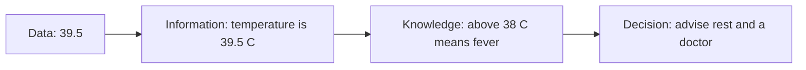
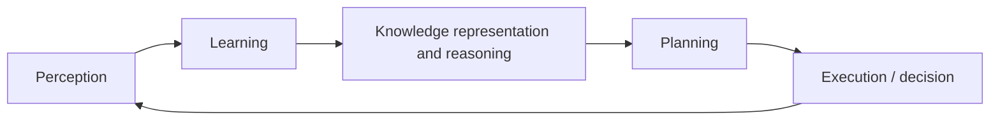
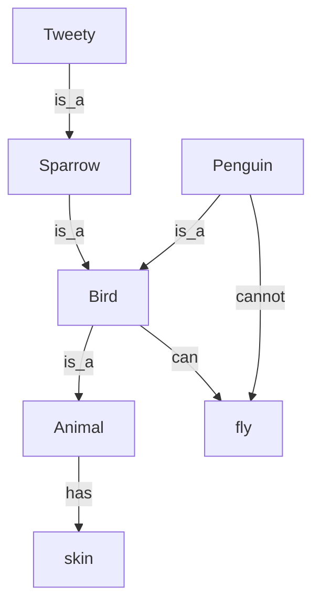

# Session 05: Knowledge Representation

> Module: AI Primer · Diploma in AI · Term 2 · ⏱ ~2 hours

A doctor diagnoses an illness because years of study have stored facts and rules in their mind: "fever plus rash may mean measles". For a computer to reason in the same way, that knowledge must be written in a form it can store and use. This is **Knowledge Representation (KR)**. In this session you will learn why KR matters, the types of knowledge, the AI knowledge cycle, and four classic ways to represent knowledge, with Python examples of each.

## 🎯 Learning Objectives

- Define knowledge representation and explain where it is used in AI
- Identify the main types of knowledge an AI system needs
- Explain the link between knowledge and intelligent behaviour
- Describe the AI knowledge cycle, including planning and decision-making
- Compare logical, semantic network, frame and production-rule representations
- Implement inheritance, frames and forward chaining in Python

## 📖 Concepts Explained

### 1. What is knowledge representation?

**Knowledge representation** is the part of AI that decides *how* facts, concepts, relationships and rules about the world are stored inside a computer so that the system can **reason** with them, answer questions and make decisions.

| Application | Knowledge it needs |
|---|---|
| Medical expert systems | Symptoms, diseases, rules linking them |
| Chatbots and assistants | Facts about products, FAQs, user context |
| Search engines (knowledge graphs) | People, places, organisations and their links |
| Robots | Map of the room, objects, what actions do |
| Fraud detection | Rules on suspicious patterns |

### 2. Types of knowledge

| Type | Meaning | Example |
|---|---|---|
| **Declarative** | Facts: "knowing that" | Karachi is in Sindh |
| **Procedural** | How to do something | Steps to change a tyre |
| **Meta-knowledge** | Knowledge about knowledge | "This rule is reliable 90% of the time" |
| **Heuristic** | Experience-based rules of thumb | "Avoid Shahrah-e-Faisal at 6 pm" |
| **Structural** | Relationships between concepts | A sparrow *is a* bird |

### 3. Knowledge and intelligence

Data on its own is not intelligence. Intelligence appears when a system **uses knowledge to choose good actions**.



More and better-organised knowledge allows better decisions, as long as the system can also *reason* with it.

### 4. The AI knowledge cycle



1. **Perception**: collect information through sensors or input (camera, text, data files).
2. **Learning**: extract patterns and new facts from what was perceived.
3. **Knowledge representation and reasoning**: store the knowledge and infer new facts.
4. **Planning**: decide the sequence of actions that reaches the goal.
5. **Execution**: act, then perceive the results and repeat.

### 5. Requirements of a good representation

- **Representational adequacy**: can express everything needed.
- **Inferential adequacy**: allows new knowledge to be derived.
- **Inferential efficiency**: reasoning is fast enough.
- **Acquisitional efficiency**: easy to add new knowledge.

### 6. Approaches to representing knowledge

| Approach | Idea | Strength | Weakness |
|---|---|---|---|
| **Logical** | Facts and rules in formal logic (Session 06) | Precise, provable | Hard to write, rigid |
| **Semantic network** | Graph of concepts joined by labelled links | Visual, supports inheritance | Unclear meaning for complex rules |
| **Frames** | Records with slots and default values | Natural for objects, defaults | Weak for complex reasoning |
| **Production rules** | IF condition THEN action | Simple, modular, used in expert systems | Many rules can conflict |

**Semantic network example:**



### 7. Reasoning with rules: forward vs backward chaining

| | Forward chaining | Backward chaining |
|---|---|---|
| Starts from | Known facts | A goal to prove |
| Direction | Facts → conclusions | Goal → required facts |
| Good for | Monitoring, "what follows from this?" | Diagnosis, "is this true?" |
| Example | Alarm systems | Medical question-answer systems |

## 💻 Code Examples

### Example 1: Semantic network with inheritance

📄 File: [`semantic_network.py`](./semantic_network.py)

```python
# semantic_network.py
# A SEMANTIC NETWORK stores knowledge as a graph: (subject, relation, object).
# Properties are INHERITED along "is_a" links.
# Command:  python semantic_network.py

# Each fact is a triple: (thing, relation, value)
facts = [
    ("Animal", "has", "skin"),
    ("Bird", "is_a", "Animal"),
    ("Bird", "can", "fly"),
    ("Bird", "has", "feathers"),
    ("Penguin", "is_a", "Bird"),
    ("Penguin", "cannot", "fly"),      # an exception to the general rule
    ("Sparrow", "is_a", "Bird"),
    ("Tweety", "is_a", "Sparrow"),
]

def parent_of(thing):
    """Return the class this thing belongs to (follow the is_a link)."""
    for subject, relation, value in facts:
        if subject == thing and relation == "is_a":
            return value
    return None

def ask(thing, relation, value):
    """Walk up the is_a chain until we find an answer."""
    current = thing
    while current is not None:
        if (current, relation, value) in facts:
            return True, current
        # An exception lower in the chain blocks the inherited fact
        if relation == "can" and (current, "cannot", value) in facts:
            return False, current
        current = parent_of(current)
    return False, None

questions = [("Tweety", "can", "fly"), ("Tweety", "has", "skin"),
             ("Penguin", "can", "fly"), ("Penguin", "has", "feathers")]

for thing, relation, value in questions:
    answer, found_at = ask(thing, relation, value)
    print(f"Query: {thing} {relation} {value:<9} -> {answer}  (decided at: {found_at})")
```

**How it works:** every fact is a triple. `ask()` looks for the fact on the object itself, then climbs the `is_a` chain (Tweety → Sparrow → Bird → Animal). The `cannot` exception for Penguin stops the general "birds can fly" fact from being inherited.

### Example 2: Frames with slots and defaults

📄 File: [`frames.py`](./frames.py)

```python
# frames.py
# FRAMES represent a stereotype object with SLOTS (attributes) and default values.
# Python classes are a natural way to write frames.
# Command:  python frames.py

class Vehicle:                       # general frame
    wheels = 4                       # default slot values
    fuel = "petrol"
    def describe(self):
        return f"{self.name}: {self.wheels} wheels, runs on {self.fuel}"

class Car(Vehicle):                  # more specific frame inherits slots
    seats = 5

class Rickshaw(Vehicle):
    wheels = 3                       # overrides the default
    fuel = "CNG"
    seats = 3

class Motorbike(Vehicle):
    wheels = 2
    seats = 2

# Instances fill the "name" slot; everything else comes from defaults
my_car = Car();        my_car.name = "Suzuki Alto"
auto = Rickshaw();     auto.name = "Qingqi Rickshaw"
bike = Motorbike();    bike.name = "Honda CD 70"
ev = Car();            ev.name = "Electric Car"; ev.fuel = "electricity"  # instance override

for item in [my_car, auto, bike, ev]:
    print(item.describe(), "| seats:", item.seats)
```

**How it works:** `Vehicle` is the general frame with default slots. `Rickshaw` and `Motorbike` override some slots, and the electric car overrides `fuel` only for itself. Any slot not filled is taken from the parent frame.

### Example 3: Production rules and forward chaining

📄 File: [`forward_chaining.py`](./forward_chaining.py)

```python
# forward_chaining.py
# PRODUCTION RULES + FORWARD CHAINING: start from known facts, keep firing
# IF-THEN rules until no new fact appears. This is how simple expert systems decide.
# Command:  python forward_chaining.py

# Knowledge base: each rule is (set of conditions, conclusion)
rules = [
    ({"has_fever", "has_cough"}, "possible_flu"),
    ({"possible_flu", "body_ache"}, "likely_flu"),
    ({"likely_flu"}, "advise_rest_and_fluids"),
    ({"has_rash", "has_fever"}, "possible_measles"),
    ({"possible_measles"}, "advise_doctor_visit"),
]

# Facts observed about one patient (the "working memory")
facts = {"has_fever", "has_cough", "body_ache"}
print("Starting facts:", sorted(facts))

round_number = 0
new_fact_added = True
while new_fact_added:                       # repeat until nothing changes
    new_fact_added = False
    round_number += 1
    for conditions, conclusion in rules:
        # A rule FIRES when all its conditions are already known facts
        if conditions.issubset(facts) and conclusion not in facts:
            facts.add(conclusion)
            new_fact_added = True
            print(f"Round {round_number}: {sorted(conditions)} => {conclusion}")

print("Final facts:", sorted(facts))
print("Advice:", [f for f in facts if f.startswith("advise")])
# Note: this toy system is for learning AI concepts, not for real medical advice.
```

**How it works:** the loop checks each rule; when all its conditions are in `facts`, the conclusion is added. New facts can make more rules fire in the next round. The loop stops when a full round adds nothing new.

## 🧪 Lab Practice

1. Add `("Ostrich", "is_a", "Bird")` and `("Ostrich", "cannot", "fly")` to the semantic network and test it.
2. Add a `Bus` frame with 6 wheels, diesel fuel and 50 seats; create one instance.
3. Change the patient's facts in `forward_chaining.py` to `{"has_fever", "has_rash"}` and read the advice.
4. Add a new rule `({"advise_doctor_visit"}, "book_appointment")` and confirm it fires in a later round.
5. Draw the knowledge cycle for a self-driving car, writing one example for each stage.

## 📝 Assignment

Build `career_advisor.py`, a forward-chaining expert system with at least 8 rules that suggests a career track (e.g. data analyst, web developer, network engineer) from facts such as `likes_maths`, `likes_design`, `enjoys_coding`. Test it with three different students and print which rules fired.

## ❓ Quick Quiz

1. "The steps to install Python" is which type of knowledge?
2. In a semantic network, which link allows inheritance?
3. Which representation uses slots and default values?
4. Forward chaining starts from facts or from a goal?
5. Name the stage in the knowledge cycle that comes right after learning.

<details><summary>Answers</summary>

1. Procedural knowledge
2. The `is_a` link
3. Frames
4. From known facts
5. Knowledge representation and reasoning

</details>

## 💼 Interview Questions

1. **Why is knowledge representation important in AI?** A system can only reason about what it can represent. Good KR lets it store facts efficiently, infer new facts and explain its decisions.
2. **Compare forward and backward chaining.** Forward chaining is data-driven: it derives every conclusion that follows from current facts. Backward chaining is goal-driven: it starts from a hypothesis and checks which facts are needed to prove it.
3. **What is a knowledge graph?** A large semantic network of real-world entities and their relationships, used by search engines and assistants to answer questions directly.

## ✅ Summary

- KR decides how an AI system stores knowledge so it can reason.
- Knowledge can be declarative, procedural, meta, heuristic or structural.
- The knowledge cycle: perceive, learn, represent and reason, plan, execute.
- Main approaches: logic, semantic networks, frames and production rules.
- Rule-based systems reason by forward or backward chaining.

---

[⬅ Previous](../Session-04-Search-Algorithms-in-AI/README.md) · [🏠 Module Home](../README.md) · [Next ➡](../Session-06-Logical-Reasoning-and-Performance-Metrics/README.md)

Prepared by Zeeshan Abbas · Aptech Learning North Nazimabad
