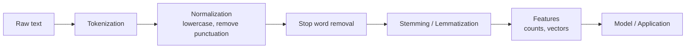

# Session 01: Introduction to NLP

> Module: AI Applications of NLP · Diploma in AI · Term 2 · ⏱ ~2 hours

When you type "best biryani near me" into Google, ask Siri for the weather, or see WhatsApp suggest your next word, a computer is working with human language. The field that makes this possible is **Natural Language Processing (NLP)**. In this first session you will learn what NLP is, where it came from, how a typical NLP pipeline looks, and which real products depend on it.

## 🎯 Learning Objectives

- Define NLP and explain why language is hard for computers
- Describe the main milestones in the history of NLP
- List the stages of a basic NLP pipeline: tokenization, normalization and stop word removal
- Recognise advanced steps: part-of-speech tagging, named entity recognition and lemmatization
- Give real-world AI applications of NLP and compare rule-based, statistical and neural approaches

## 📖 Concepts Explained

### 1. What is NLP?

**Natural Language Processing** is the branch of AI that helps computers read, understand and produce human language (text and speech). It sits where three subjects meet: **linguistics** (how language works), **computer science** (algorithms) and **machine learning** (learning from data).

> **Analogy:** A new student from another city understands Urdu words but not local slang. Over time, by hearing many examples, they learn the meaning. NLP systems learn language the same way: from lots of examples.

### 2. Why is language hard for a computer?

| Challenge | Example | Why it is difficult |
|---|---|---|
| Ambiguity | "I saw her duck" | duck = the bird, or bending down? |
| Synonyms | buy / purchase / get | different words, same meaning |
| Context | "That was sick!" | can mean great or ill |
| Spelling and slang | "gr8", "plz", "kya scene hai" | not in any dictionary |
| Many languages | English, Urdu, Roman Urdu, Sindhi | each needs its own rules |

### 3. A short history of NLP

| Period | Approach | Example |
|---|---|---|
| 1950s-1980s | **Rule-based**: experts write grammar rules | ELIZA chatbot (1966), early translators |
| 1990s-2000s | **Statistical**: count words, use probability | spam filters, phrase-based Google Translate |
| 2013-2017 | **Neural networks + word embeddings** | Word2Vec, LSTM translators |
| 2018-today | **Transformers and Large Language Models (LLMs)** | BERT, GPT, ChatGPT, Gemini |

### 4. Why NLP matters in AI

Most of the world's information is unstructured text: emails, reviews, news, chats, medical notes. NLP turns that text into something a program can search, count, classify and answer questions about. Without NLP, AI could only work with tidy tables of numbers.

### 5. The NLP pipeline

Raw text cannot go straight into a model. It passes through a pipeline of small steps:



| Stage | What it does | Input -> Output |
|---|---|---|
| Tokenization | Splits text into words or sentences | "I love NLP" -> ["I", "love", "NLP"] |
| Normalization | Makes text consistent | "FAST", "Fast" -> "fast" |
| Stop word removal | Removes very common words | ["the", "bus", "is", "late"] -> ["bus", "late"] |
| Lemmatization | Reduces words to dictionary form | "running", "ran" -> "run" |

### 6. Advanced NLP steps (preview)

- **Part-of-Speech (POS) tagging** labels each word as noun, verb, adjective and so on.
- **Named Entity Recognition (NER)** finds names of people, places, organisations, dates and amounts.
- **Lemmatization** uses a dictionary to find the base form of a word ("better" -> "good").

You will study each of these in detail in Sessions 02 and 03.

### 7. Real-world applications

| Application | NLP task behind it | Pakistani example |
|---|---|---|
| Customer reviews | Sentiment analysis | Daraz product ratings |
| Email | Spam detection | Gmail filters |
| Search | Information retrieval | Google, Zameen.com search |
| Voice assistants | Speech-to-text + intent detection | "Hey Google, call Ammi" |
| Translation | Machine translation | Google Translate English <-> Urdu |
| Chatbots | Dialogue systems | Bank helplines on WhatsApp |

### 8. Comparing NLP approaches

| Approach | Strength | Weakness | Good for |
|---|---|---|---|
| Rule-based | Easy to explain, no data needed | Breaks on new wording | Dates, phone numbers, CNIC formats |
| Statistical ML | Learns from labelled data | Needs feature engineering | Spam, topic classification |
| Deep learning / LLMs | Understands context, very accurate | Needs lots of data and compute | Translation, chat, summarisation |

## 💻 Code Examples

> **One-time setup:** install the libraries with `pip install nltk scikit-learn numpy`, then run [`setup_nltk.py`](./setup_nltk.py) once to download NLTK data. Every later session assumes this is done.

### Example 1: a pipeline in plain Python (`pipeline_basics.py`)

```python
# pipeline_basics.py
# The first three stages of an NLP pipeline using ONLY plain Python.
# Stage 1: tokenization  Stage 2: normalization  Stage 3: stop word removal
# Command:  python pipeline_basics.py

import re

text = "The new Metro bus in Karachi is FAST! I love the new Metro bus."

# Stage 1: Tokenization -> split the text into words (tokens)
tokens = re.findall(r"[A-Za-z]+", text)   # keep letters only, drop "!" and "."
print("1. Tokens:          ", tokens)

# Stage 2: Normalization -> make every token lowercase
lower_tokens = [word.lower() for word in tokens]
print("2. Lowercase tokens:", lower_tokens)

# Stage 3: Stop word removal -> remove very common words that carry little meaning
stop_words = {"the", "is", "in", "a", "an", "i", "and", "of", "to"}
content_words = [word for word in lower_tokens if word not in stop_words]
print("3. Content words:   ", content_words)

# Bonus: count how often each content word appears
counts = {}
for word in content_words:
    counts[word] = counts.get(word, 0) + 1
print("Word counts:        ", counts)
```

**How it works**

- `re.findall(r"[A-Za-z]+", text)` keeps only runs of letters, so punctuation disappears.
- A list comprehension lowercases every token so "Metro" and "metro" become the same word.
- A small `set` of stop words is checked for each token; only meaningful words remain.
- A dictionary counts each word. This "bag of words" is the simplest way to turn text into numbers.

### Example 2: a tour of NLP tasks with NLTK (`nlp_tour.py`)

```python
# nlp_tour.py
# A quick tour of classic NLP tasks with NLTK.
# First run setup_nltk.py once.   Command:  python nlp_tour.py

import nltk
from nltk.stem import WordNetLemmatizer

sentence = "Ayesha visited Lahore in March and bought three books."

# 1) Tokenization: split the sentence into words
words = nltk.word_tokenize(sentence)
print("Tokens:", words)

# 2) Part-of-speech tagging: label each word as noun, verb, etc.
tags = nltk.pos_tag(words)
print("POS tags:", tags)          # NNP = proper noun, VBD = past-tense verb ...

# 3) Lemmatization: reduce a word to its dictionary form
lemmatizer = WordNetLemmatizer()
print("Lemma of 'books':", lemmatizer.lemmatize("books"))            # book
print("Lemma of 'bought':", lemmatizer.lemmatize("bought", pos="v"))  # buy

# 4) Named Entity Recognition: find names of people, places ...
tree = nltk.ne_chunk(tags)
for chunk in tree:
    if hasattr(chunk, "label"):                         # entities are sub-trees
        entity = " ".join(word for word, tag in chunk)
        print("Entity:", entity, "->", chunk.label())
```

**How it works**

- `word_tokenize` is a smarter tokenizer that also keeps punctuation as separate tokens.
- `pos_tag` returns pairs like `('visited', 'VBD')`: the word and its grammar label.
- `WordNetLemmatizer` looks words up in a dictionary; `pos="v"` tells it the word is a verb.
- `ne_chunk` groups tagged words into entities such as `PERSON` and `GPE` (a geo-political place).

Expected output (last lines):

```text
Entity: Ayesha -> PERSON
Entity: Lahore -> GPE
```

## 🧪 Lab Practice

1. Install Python 3.12, then run `pip install nltk scikit-learn numpy` and `python setup_nltk.py`.
2. Run `pipeline_basics.py`. Change `text` to a sentence about your own city and run it again.
3. Add the words `"love"` and `"new"` to `stop_words`. What changes in the counts?
4. Run `nlp_tour.py` with the sentence "Imran Khan spoke at the University of Karachi on Monday." Which entities are found? Which are missed?
5. In a notebook, list five apps on your phone that use NLP and name the NLP task each one uses.

## 📝 Assignment

Write `my_pipeline.py` that reads a short paragraph (at least 4 sentences) about any topic, then prints: the number of tokens, the number of unique words after lowercasing, the content words after stop word removal, and the 3 most frequent content words.

## ❓ Quick Quiz

1. What does NLP stand for?
2. Name the three subjects that NLP combines.
3. Which pipeline stage turns "I love NLP" into three separate items?
4. Which era of NLP introduced models like BERT and GPT?
5. Why do we remove stop words?

<details>
<summary>Show answers</summary>

1. Natural Language Processing
2. Linguistics, computer science and machine learning
3. Tokenization
4. The transformer / Large Language Model era (2018 onwards)
5. They appear very often but carry little meaning, so removing them reduces noise and size

</details>

## 💼 Interview Questions

1. **What is the difference between NLP, NLU and NLG?** NLP is the whole field. NLU (Natural Language Understanding) focuses on reading meaning from text; NLG (Natural Language Generation) focuses on producing text.
2. **Why is ambiguity a major problem in NLP?** One word or sentence can have several meanings, and the right one depends on context that the computer must infer.
3. **When would you choose a rule-based approach over machine learning?** When the pattern is fixed and well defined (dates, emails, phone numbers) or when there is no labelled data.

## ✅ Summary

- NLP lets computers read, understand and produce human language.
- It moved from hand-written rules to statistics, then neural networks and today's LLMs.
- A basic pipeline is: tokenize, normalize, remove stop words, then lemmatize.
- POS tagging and NER add grammar and meaning on top of the basic pipeline.
- NLP powers search, chatbots, translation, reviews, spam filters and voice assistants.

---

[🏠 Module Home](../README.md) · [Next ➡](../Session-02-Text-Preprocessing-Techniques/README.md)

Prepared by Zeeshan Abbas · Aptech Learning North Nazimabad
