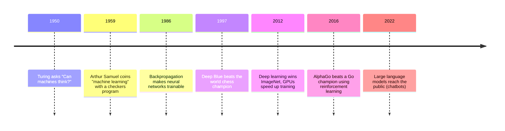
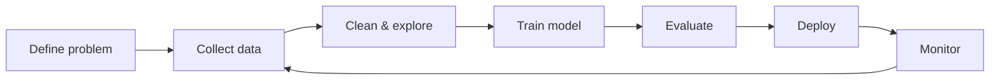

# Session 01: Introduction to Machine Learning

> Module: Applied Machine Learning using Python · Diploma in AI · Term 2 · ⏱ ~2 hours

When JazzCash flags a strange transaction, or YouTube decides which video to show next, nobody wrote an `if` statement for every possible user. The system **learned patterns from past data**. This session explains what Machine Learning (ML) is, how it grew over the decades, why it is now the normal way to process data, and why every ML engineer must think about fairness and ethics from day one.

## 🎯 Learning Objectives

- Explain what Machine Learning is and how it differs from normal rule-based programming
- Describe the key milestones in the history of ML
- Identify real-world applications of ML in data processing
- Recognise common ethical issues in AI: bias, privacy, transparency and accountability
- Run a complete ML workflow in Python with scikit-learn

## 📖 Concepts Explained

### 1. What is Machine Learning?

**Machine Learning** is a way of building software where the computer finds the rules by itself by studying examples, instead of a programmer typing every rule.

| Traditional programming | Machine Learning |
|---|---|
| Input: data + rules | Input: data + correct answers |
| Output: answers | Output: rules (a *model*) |
| Rules written by a human | Rules learned from examples |
| Hard to update | Re-train with new data |

> Analogy: a child is not given a dictionary definition of "cat". You show many pictures of cats and say "cat". After a while the child recognises new cats. ML works the same way.

### 2. Key vocabulary

| Term | Meaning | Example |
|---|---|---|
| Dataset | a table of examples | 10,000 past loan applications |
| Feature | an input column | income, age, city |
| Label / target | the answer we want to predict | repaid or not |
| Model | the learned pattern | a decision tree |
| Training | the learning step (`fit`) | `model.fit(X, y)` |
| Prediction | using the model on new data | `model.predict(new_row)` |

### 3. A short history



ML became practical only recently because three things arrived together: **lots of data**, **cheap computing (GPUs, cloud)** and **better algorithms**.

### 4. Types of ML (quick recap)

| Type | Data | Typical task | Session in this module |
|---|---|---|---|
| Supervised | features + labels | classify, predict a number | 4-8 |
| Unsupervised | features only | find groups, compress data | 2 |
| Reinforcement | rewards from an environment | learn actions step by step | 3 |

### 5. Why use ML for data processing?

Data today is too big and changes too fast for hand-written rules. ML helps to:

- **Classify**: spam vs normal email, fraud vs genuine payment
- **Predict**: next month's electricity demand, house prices
- **Group**: customer segments for marketing
- **Detect anomalies**: unusual sensor readings in a factory
- **Recommend**: products on Daraz, songs on Spotify
- **Automate cleaning**: fill missing values, detect duplicate records

### 6. Ethics in AI: why it matters from day one

A model learns from history. If history is unfair, the model copies the unfairness, and then repeats it thousands of times per second.

| Issue | What can go wrong | Real-world style example |
|---|---|---|
| Bias | some groups get worse results | a hiring tool that preferred male CVs because past hires were mostly men |
| Privacy | personal data is leaked or misused | location data sold without consent |
| Transparency | nobody can explain the decision | a loan is rejected and the bank cannot say why |
| Accountability | unclear who is responsible | a self-driving car accident |
| Safety | wrong prediction harms people | a medical model misses a disease in one age group |

**Fairness** means a model should not perform much worse, or decide much more harshly, for one group (gender, city, age, language) than for another. A common cause is **unbalanced data**: if 90% of training rows come from one city, the model learns that city well and others badly. You will see this in `fairness_check.py`.

### 7. ML project workflow



## 💻 Code Examples

Install once: `pip install scikit-learn pandas matplotlib numpy`

### Example 1: Rules vs learning (`rules_vs_learning.py`)

```python
from sklearn.tree import DecisionTreeClassifier

students = [[1, 4], [2, 6], [3, 5], [5, 10], [6, 12], [7, 11], [8, 14], [2, 3]]
results = [0, 0, 0, 1, 1, 1, 1, 0]

def rule_based(hours, classes):
    if hours >= 4:
        return 1
    return 0

model = DecisionTreeClassifier(max_depth=2, random_state=0)
model.fit(students, results)
print(model.predict([[3, 12]]))
```

**How it works:** the function `rule_based` contains a rule a human guessed. The decision tree looks at the eight examples and builds its own rule. For a student with 3 hours but 12 classes, the rule says "fail" while the model, which also looks at attendance, says "pass".

### Example 2: Your first full ML model (`first_ml_model.py`)

```python
from sklearn.datasets import load_iris
from sklearn.model_selection import train_test_split
from sklearn.neighbors import KNeighborsClassifier
from sklearn.metrics import accuracy_score

iris = load_iris()
X_train, X_test, y_train, y_test = train_test_split(
    iris.data, iris.target, test_size=0.3, random_state=42)
model = KNeighborsClassifier(n_neighbors=5)
model.fit(X_train, y_train)
print(accuracy_score(y_test, model.predict(X_test)))
```

**How it works:** we split the data so the model is tested on flowers it has never seen. `fit` trains, `predict` answers, and `accuracy_score` compares answers with the truth. This load → split → train → predict → evaluate pattern is used in every session of this module.

### Example 3: Checking fairness between groups (`fairness_check.py`)

```python
for g in ["A", "B"]:
    mask = group == g
    acc = (predicted[mask] == repaid[mask]).mean()
    print(f"Group {g}: rows={mask.sum()}, accuracy={acc:.2f}")
```

**How it works:** the file builds a toy loan dataset where city B has only 40 rows. One model is trained on everyone, then accuracy is measured **per group**. Output is about 0.96 for group A and 0.62 for group B: the same model is far less reliable for the smaller group. Overall accuracy alone would hide this problem.

## 🧪 Lab Practice

1. Run `first_ml_model.py`. Change `n_neighbors` to 1, 3, 15 and note the accuracy each time.
2. Change `test_size` to 0.5. Does accuracy change? Why might a smaller training set hurt?
3. In `rules_vs_learning.py`, add three more students and retrain. Do the predictions change?
4. In `fairness_check.py`, change group B to 400 rows. What happens to its accuracy?
5. Draw (on paper) the ML workflow for a "predict student dropout" project at your center.

## 📝 Assignment

Pick one ML application you use in daily life (e.g. Careem fare estimate, Gmail spam filter). Write one page covering: the features it probably uses, the label it predicts, which ML type it is, and two ethical risks with one way to reduce each.

## ❓ Quick Quiz

1. In ML, what is a "label"?
2. Who used the phrase "machine learning" in 1959?
3. Which three factors made ML practical in the 2010s?
4. Why can overall accuracy hide unfairness?
5. Which scikit-learn method trains a model?

<details>
<summary>Show answers</summary>

1. The correct answer (target) the model should learn to predict.
2. Arthur Samuel.
3. Large datasets, cheap computing power (GPUs/cloud) and improved algorithms.
4. A large group with high accuracy can hide a small group with low accuracy; you must measure per group.
5. `fit()`.

</details>

## 💼 Interview Questions

**1. How is machine learning different from traditional programming?**

> In traditional programming a developer writes the rules. In ML the algorithm learns the rules (a model) from examples of inputs and correct outputs, and can be re-trained when data changes.

**2. What is algorithmic bias and where does it come from?**

> It is when a model gives systematically worse or unfair results for a group. It usually comes from unrepresentative or historically biased training data, poor feature choices or evaluation that ignores sub-groups.

**3. Why do we split data into training and test sets?**

> To measure how the model performs on unseen data. Testing on training data gives an over-optimistic score and hides overfitting.

## ✅ Summary

- ML learns rules from data instead of a programmer writing them.
- Data, compute and algorithms together made ML mainstream.
- ML is used to classify, predict, group, detect anomalies and recommend.
- Bias, privacy, transparency and accountability are core ethical issues.
- Always check model performance per group, not only overall.

---

⬅ Previous · [🏠 Module Home](../README.md) · [Next ➡](../Session-02-Advanced-Clustering-and-Dimensionality-Reduction/README.md)

Prepared by Zeeshan Abbas · Aptech Learning North Nazimabad
