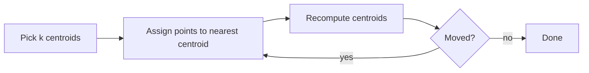

# Session 02: Advanced Clustering and Dimensionality Reduction

> Module: Applied Machine Learning using Python · Diploma in AI · Term 2 · ⏱ ~2 hours

A supermarket in Gulshan has 50,000 loyalty-card customers but no labels saying who is a "bargain hunter" or a "premium buyer". **Clustering** finds such groups automatically. And when each customer has 100 columns, **dimensionality reduction** squeezes them into a few meaningful numbers so we can see, plot and model them. Both are **unsupervised** techniques: no labels are needed.

## 🎯 Learning Objectives

- Define clustering and list common tools and application areas
- Compare K-Means, hierarchical clustering and DBSCAN, and know when to use each
- Choose the number of clusters using the elbow method and silhouette score
- Explain why high-dimensional data is a problem (the "curse of dimensionality")
- Apply PCA and t-SNE to reduce features to 2D for visualisation

## 📖 Concepts Explained

### 1. What is clustering?

Clustering puts similar rows in the same group and different rows in different groups. "Similar" usually means **close in distance** (e.g. Euclidean distance between feature values).

| Application | What gets grouped |
|---|---|
| Customer segmentation | shoppers by spending habits |
| Document organisation | news articles by topic |
| Anomaly detection | normal vs strange network traffic |
| Image compression | similar pixel colours |
| Healthcare | patients with similar symptoms |

**Tools:** scikit-learn (`sklearn.cluster`), SciPy (dendrograms), and visual tools such as Orange or Power BI clustering visuals.

### 2. K-Means

1. Choose `k` (number of groups).
2. Place `k` centre points (centroids) randomly.
3. Assign each point to its nearest centroid.
4. Move each centroid to the average of its points.
5. Repeat steps 3-4 until centroids stop moving.



> Always **scale** features first (`StandardScaler`). Otherwise a column measured in thousands (income) dominates a column measured in tens (age).

### 3. Choosing k

| Method | Idea | Read it as |
|---|---|---|
| Elbow (inertia) | total distance of points to their centroid | pick k where the curve bends like an elbow |
| Silhouette score | how close a point is to its own cluster vs the next one (-1 to 1) | pick the k with the highest score |

### 4. Hierarchical (agglomerative) clustering

Starts with every row as its own cluster and repeatedly merges the two closest clusters, building a tree called a **dendrogram**. You cut the tree at the height that gives the number of groups you want. Good for small datasets and when you want to see the "family tree" of groups. `linkage="ward"` merges groups that increase variance the least.

### 5. DBSCAN (density-based)

DBSCAN grows clusters from **dense** areas. Two settings: `eps` (neighbourhood radius) and `min_samples` (points needed to be dense). Points in sparse areas get label **-1 = noise**.

| | K-Means | Hierarchical | DBSCAN |
|---|---|---|---|
| Need k in advance? | yes | yes (or cut tree) | no |
| Cluster shape | round blobs | flexible | any shape |
| Handles noise/outliers | poorly | poorly | yes (label -1) |
| Large data | fast | slow | medium |

### 6. Dimensionality reduction

With many features, points become far apart from each other, distances stop being meaningful, models slow down and overfit. This is the **curse of dimensionality**. Two families of fixes:

- **Feature selection**: keep the best original columns (Session 5).
- **Feature extraction**: create a few new columns that summarise many.

| Technique | Type | Best for |
|---|---|---|
| PCA (Principal Component Analysis) | linear | speeding up models, removing correlated features |
| t-SNE | non-linear | 2D pictures of clusters (visual only) |
| UMAP | non-linear | like t-SNE, faster (separate `umap-learn` package) |
| LDA (Linear Discriminant Analysis) | linear, supervised | reducing features while keeping classes apart |

**PCA** finds new axes (principal components) along which the data varies the most. `explained_variance_ratio_` tells you how much information each component keeps.

## 💻 Code Examples

### Example 1: Customer segments with K-Means (`kmeans_customers.py`)

```python
scaled = StandardScaler().fit_transform(data)
kmeans = KMeans(n_clusters=4, n_init=10, random_state=0)
data["segment"] = kmeans.fit_predict(scaled)
print(data.groupby("segment").mean().round(1))
```

**How it works:** income and spending are scaled, K-Means assigns each customer a segment number, and the group averages let us give business names, e.g. "high income, low spending". The chart is saved as `kmeans_segments.png`.

### Example 2: Choosing k (`elbow_and_silhouette.py`)

```python
for k in range(2, 9):
    model = KMeans(n_clusters=k, n_init=10, random_state=0)
    labels = model.fit_predict(X)
    print(k, model.inertia_, silhouette_score(X, labels))
```

**How it works:** the data truly has 4 blobs. Inertia drops sharply until k=4 then flattens (the elbow), and silhouette is highest (~0.81) at k=4. Both plots are saved to `elbow_silhouette.png`.

### Example 3: DBSCAN vs K-Means on moon shapes (`dbscan_vs_kmeans.py`)

```python
kmeans_labels = KMeans(n_clusters=2, n_init=10, random_state=0).fit_predict(X)
dbscan_labels = DBSCAN(eps=0.2, min_samples=5).fit_predict(X)
```

**How it works:** K-Means draws a straight boundary and cuts both moons in half. DBSCAN follows the dense curve and finds each moon correctly. Compare them in `dbscan_vs_kmeans.png`.

### Example 4: Hierarchical clustering (`hierarchical_clustering.py`)

```python
model = AgglomerativeClustering(n_clusters=3, linkage="ward")
groups = model.fit_predict(marks)
```

**How it works:** eight students' Maths/English marks are merged bottom-up into three natural groups: strong in both, English-only, Maths-only.

### Example 5: PCA and t-SNE (`pca_and_tsne.py`)

```python
pca = PCA(n_components=2)
X_pca = pca.fit_transform(X)
X_tsne = TSNE(n_components=2, random_state=0, init="pca").fit_transform(X)
```

**How it works:** each digit image has 64 pixel features. Both methods turn them into 2 numbers for plotting. PCA keeps only ~28% of the variance, so digits overlap; t-SNE separates the ten digits into clear islands. See `pca_vs_tsne.png`.

## 🧪 Lab Practice

1. In `kmeans_customers.py` try `n_clusters=3` and `5`. Which result is easiest to explain to a manager?
2. In `elbow_and_silhouette.py` change `centers=4` to `centers=6`. Do both methods now point to 6?
3. In `dbscan_vs_kmeans.py` set `eps=0.05`, then `eps=0.5`. Describe what happens to noise and clusters.
4. Print `pca.explained_variance_ratio_` for `n_components=10`. How many components keep 70% of variance?
5. Remove the `StandardScaler` step in Example 1 and compare the segments.

## 📝 Assignment

Use `sklearn.datasets.load_wine()` (13 features). Scale it, reduce to 2 components with PCA, cluster with K-Means (choose k using silhouette), and save a scatter plot coloured by cluster. Write 5 lines comparing your clusters with the real wine classes (`wine.target`).

## ❓ Quick Quiz

1. Why is clustering called unsupervised learning?
2. What does a silhouette score close to 1 mean?
3. Which algorithm labels outliers as -1?
4. What does `explained_variance_ratio_` show in PCA?
5. Should t-SNE output be used as features for a production model? Why?

<details>
<summary>Show answers</summary>

1. It works without labels; it discovers structure on its own.
2. Points are well inside their own cluster and far from other clusters.
3. DBSCAN.
4. The share of the original variance (information) kept by each principal component.
5. Usually no. t-SNE is for visualisation; it cannot transform new rows consistently and distances between far clusters are not meaningful.

</details>

## 💼 Interview Questions

**1. What are the limitations of K-Means?**

> You must choose k; it assumes round, similar-size clusters; it is sensitive to scaling, outliers and the random starting centroids (use `n_init` and k-means++).

**2. When would you prefer DBSCAN?**

> When clusters have irregular shapes, the number of clusters is unknown, or the data contains noise/outliers you want flagged.

**3. Explain PCA in simple words.**

> PCA rotates the data to new axes ordered by how much the data spreads along them, then keeps only the first few axes, compressing many correlated features into fewer uncorrelated ones.

## ✅ Summary

- Clustering groups similar rows without labels.
- K-Means is fast for round clusters; hierarchical gives a dendrogram; DBSCAN finds any shape and flags noise.
- Use elbow and silhouette to choose k, and always scale features.
- PCA compresses features linearly; t-SNE is for visual cluster maps.

---

[⬅ Previous](../Session-01-Introduction-to-Machine-Learning/README.md) · [🏠 Module Home](../README.md) · [Next ➡](../Session-03-Markov-Decision-Process-and-Reinforcement-Learning/README.md)

Prepared by Zeeshan Abbas · Aptech Learning North Nazimabad
